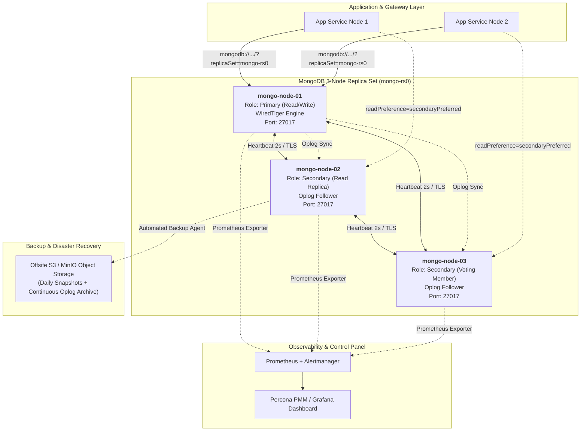
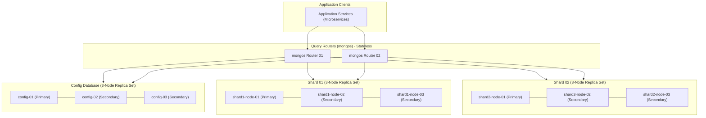
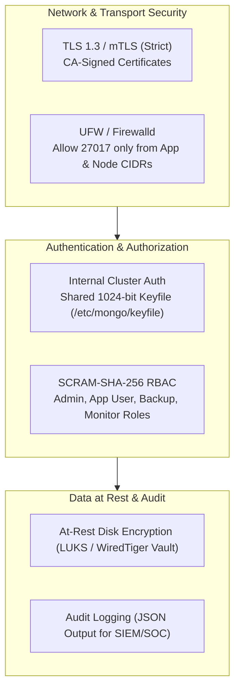
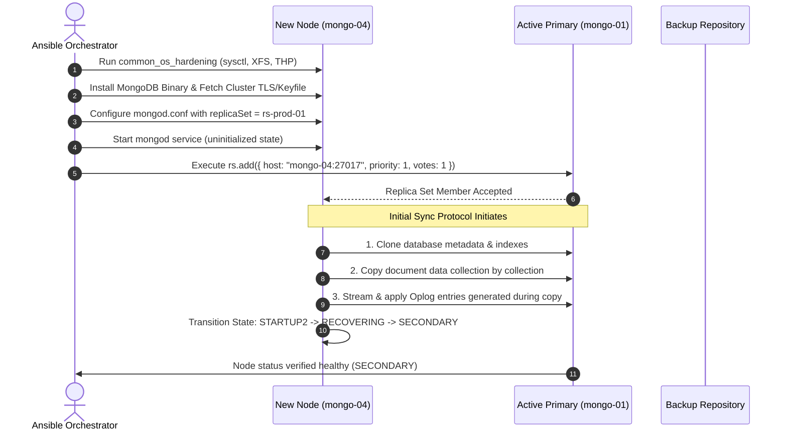
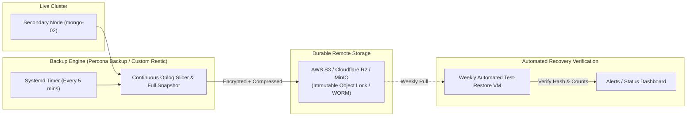
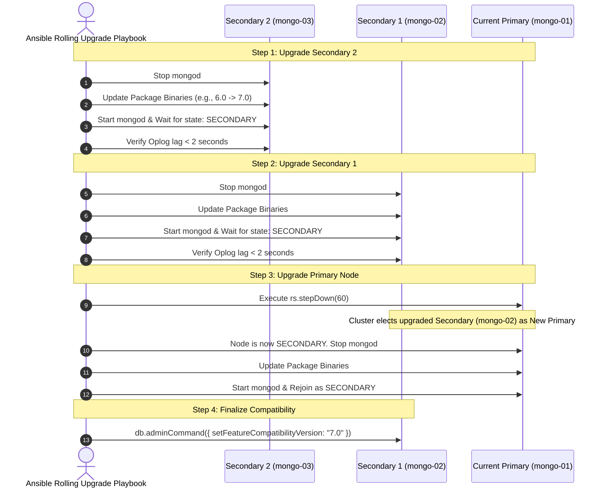
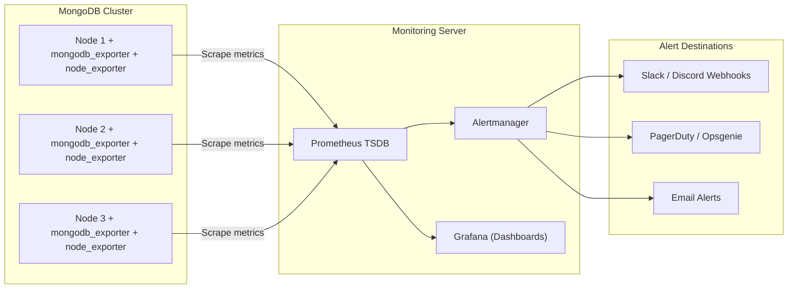
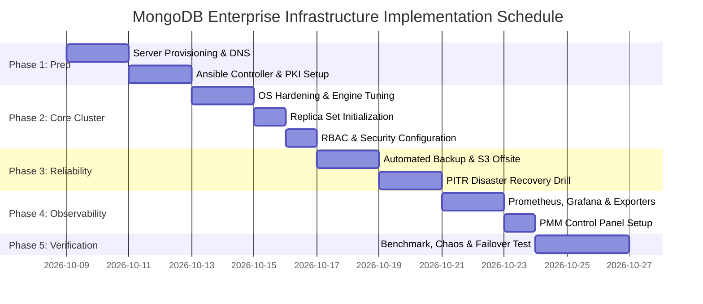

# Enterprise Production-Grade MongoDB Cluster with Ansible Automation
### High Availability, Automated Backup, PITR, Zero-Downtime Upgrades, Observability & Scaling Architecture

---

## 1. Executive Overview

This specification outlines the architecture, automation blueprints, security posture, and lifecycle operations for deploying an enterprise-grade, high-performance **MongoDB (Replica Set & Sharded)** cluster managed end-to-end with **Ansible**.

### Key Highlights
- **Topology:** 3-Node High-Availability Replica Set (1 Primary + 2 Secondaries) with automated failover (< 3s detection).
- **Automation Engine:** Ansible with idempotent roles, inventory-driven configuration, and Ansible Vault for secret governance.
- **Security:** Strict TLS 1.3 in-transit encryption, replica set internal keyfile authentication, SCRAM-SHA-256 RBAC, network isolation (UFW/Firewalld), and OS hardening.
- **Performance:** WiredTiger engine tuned for low latency, XFS filesystem with `noatime`, disabled Transparent Huge Pages (THP), optimized kernel TCP/memory sysctls, and NVMe I/O scheduling.
- **Resilience & DR:** Automated continuous backup with Oplog archiving for Point-In-Time Recovery (PITR) to remote Object Storage (S3/MinIO), with automated restore drill validation.
- **Lifecycle & Maintenance:** Zero-downtime rolling upgrades, automated feature compatibility version (`FCV`) management, and automated dynamic replica scaling.
- **Observability:** Prometheus + `mongodb_exporter` + Grafana + Alertmanager with Percona Monitoring and Management (PMM) control panel.

---

## 2. System Architecture & Topologies

### 2.1 Three-Node Production Replica Set Topology
The base production deployment consists of 3 dedicated virtual/bare-metal nodes across isolated availability zones (or separate racks) to ensure quorum and prevent split-brain.



---

### 2.2 Horizontal Scaling Architecture (Sharded Cluster Evolution)
When write throughput or dataset size exceeds a single replica set's capability (e.g. > 2-3 TB or > 10,000 IOPS writes), the architecture scales into a sharded cluster with zero code changes in client applications.



---

## 3. Infrastructure & System Prerequisites

### 3.1 Hardware Sizing Recommendations

| Component | Minimum (Staging / Dev) | Recommended Production (General) | High-Throughput Production |
| :--- | :--- | :--- | :--- |
| **Nodes** | 3 Instances | 3 Dedicated Instances | 3 Bare-metal / Dedicated VMs |
| **vCPU** | 4 Cores | 8 - 16 Cores | 16 - 32 Cores |
| **RAM** | 8 GB | 32 - 64 GB ECC | 128 GB+ ECC |
| **Disk Type** | SSD (SATA) | NVMe SSD (PCIe Gen4) | Enterprise NVMe RAID 10 |
| **Disk Size** | 100 GB | 500 GB - 2 TB | 4 TB+ with dynamic LVM expansion |
| **IOPS** | 3,000 IOPS | 10,000+ IOPS (Burst 20k) | 30,000+ sustained IOPS |
| **Network** | 1 Gbps | 10 Gbps Private Subnet | 25 Gbps Dual Bonded (LACP) |

### 3.2 Operating System & Kernel Requirements
- **Supported OS:** Ubuntu 22.04 LTS / 24.04 LTS or Rocky Linux 9 / RHEL 9 (64-bit x86_64 or ARM64).
- **Filesystem:** Dedicated partition formatted with **XFS** (Required for WiredTiger engine performance; ext4 has known allocation stalls under heavy write load).
- **Mount Options:** `defaults,noatime,nodiratime,allocsize=64M`.
- **Clock Synchronization:** `chrony` or `systemd-timesyncd` configured with jitter < 5ms (critical for replica consensus and oplog ordering).

### 3.3 Ansible Control Node Requirements
- Ansible Core `>= 2.15.0`
- Python `>= 3.10` with packages: `pymongo >= 4.5`, `cryptography >= 41.0`, `jmespath`, `boto3` (for S3 backups)
- Ansible Collections:
  - `community.mongodb`
  - `ansible.posix`
  - `community.general`
  - `community.crypto`

---

## 4. Production Performance Tuning (OS & Database Engine)

A production-grade MongoDB node requires strict OS and engine optimization. Ansible will automate these configurations:

### 4.1 Kernel Sysctl Parameters (`/etc/sysctl.d/99-mongodb.conf`)
```ini
# Virtual Memory Tuning
vm.swappiness = 1
vm.dirty_ratio = 15
vm.dirty_background_ratio = 5
vm.max_map_count = 1048576

# Network Tuning for High-Concurrency Connections
net.core.somaxconn = 65535
net.ipv4.tcp_max_syn_backlog = 65535
net.ipv4.tcp_fin_timeout = 15
net.ipv4.tcp_keepalive_time = 300
net.ipv4.tcp_keepalive_intvl = 60
net.ipv4.tcp_keepalive_probes = 5
net.ipv4.tcp_tw_reuse = 1

# File Descriptors
fs.file-max = 2097152
```

### 4.2 Transparent Huge Pages (THP) Deactivation
MongoDB WiredTiger operates with its own cache management. Transparent Huge Pages (THP) lead to memory fragmentation, severe latency spikes, and OOM kills.
- Ansible creates a systemd service `/etc/systemd/system/disable-thp.service` executing before `mongod`:
  ```bash
  echo never > /sys/kernel/mm/transparent_hugepage/enabled
  echo never > /sys/kernel/mm/transparent_hugepage/defrag
  ```

### 4.3 Process Limits (`/etc/security/limits.d/99-mongodb.conf`)
```text
mongod soft nofile 100000
mongod hard nofile 100000
mongod soft nproc 64000
mongod hard nproc 64000
mongod soft memlock unlimited
mongod hard memlock unlimited
```

### 4.4 WiredTiger Engine Sizing (`mongod.conf`)
- **Cache Size Formula:**
  $$\text{WiredTiger Cache} = \max\left(0.5 \times (\text{RAM} - 1\text{ GB}),\ 256\text{ MB}\right)$$
- If the node has 64 GB RAM, WiredTiger Cache should be set to:
  $$\approx 0.5 \times (64 - 1) = 31.5\text{ GB}$$
  Leaving the remaining 32.5 GB for OS filesystem cache, MongoDB connection overhead, aggregation memory, and background processes.

---

## 5. Security & Access Governance Architecture



### 5.1 TLS / mTLS In-Transit Encryption
- Automated internal Certificate Authority (CA) created via Ansible Vault or integration with HashiCorp Vault / cert-manager.
- Each MongoDB member gets its own SAN certificate containing its FQDN and private IP.
- Clients connect using TLS with CA validation:
  ```yaml
  net:
    port: 27017
    bindIp: 0.0.0.0
    tls:
      mode: requireTLS
      certificateKeyFile: /etc/ssl/mongodb/mongo.pem
      CAFile: /etc/ssl/mongodb/ca.crt
      allowConnectionsWithoutCertificates: false
  ```

### 5.2 Internal Replica Authentication
- High-entropy cryptographic keyfile generated once and securely synced across all 3 nodes with strict permissions (`chmod 400`, owner `mongod:mongod`).
  ```yaml
  security:
    keyFile: /etc/mongodb/mongo-keyfile
    authorization: enabled
  ```

### 5.3 Granular Role-Based Access Control (RBAC)
Ansible idempotently provisions isolated system accounts:
1. `clusterAdmin` / `userAdminAnyDatabase`: Root cluster administration.
2. `appUser`: ReadWrite permissions restricted strictly to the project database (e.g., `prod_db`).
3. `backupUser`: Roles `backup` and `restore` for automated snapshot and oplog streaming.
4. `monitorUser`: Roles `clusterMonitor` for Prometheus `mongodb_exporter` with read-only access to `admin.serverStatus()`.

---

## 6. Ansible Automation Architecture & Codebase Design

### 6.1 Directory Structure
```text
ansible-mongodb/
├── ansible.cfg
├── inventory/
│   ├── production/
│   │   ├── hosts.ini
│   │   └── group_vars/
│   │       ├── all.yml
│   │       ├── mongodb_cluster.yml
│   │       └── vault.yml            # Encrypted passwords, certs, keyfiles
├── playbooks/
│   ├── 01_site_deploy_cluster.yml   # Complete provisioning
│   ├── 02_scale_add_node.yml        # Scale out replica set
│   ├── 03_rolling_upgrade.yml       # Zero-downtime version upgrade
│   ├── 04_trigger_backup.yml        # On-demand or scheduled backup
│   ├── 05_disaster_recovery.yml     # Restore from backup + PITR
│   └── 06_observability_deploy.yml  # Deploy exporters + PMM client
└── roles/
    ├── common_os_hardening/         # Kernel tuning, sysctl, THP, limits, firewall
    ├── mongodb_install/             # Repositories, packages, binaries
    ├── mongodb_pki/                 # CA certs, node certs generation & distribution
    ├── mongodb_configure/           # mongod.conf, systemd override, keyfile
    ├── mongodb_replicaset_init/     # rs.initiate(), add members, priority weighting
    ├── mongodb_users/               # RBAC users creation
    ├── mongodb_backup_agent/        # Automated backup scripts, cron, S3 upload
    ├── mongodb_monitoring/          # mongodb_exporter, node_exporter
    └── mongodb_upgrade/             # Rolling upgrade orchestrator
```

### 6.2 Production Inventory Specification (`hosts.ini`)
```ini
[mongodb_cluster]
mongo-01 ansible_host=10.0.10.11 mongo_node_role=primary   mongo_priority=2 mongo_votes=1
mongo-02 ansible_host=10.0.10.12 mongo_node_role=secondary mongo_priority=1 mongo_votes=1
mongo-03 ansible_host=10.0.10.13 mongo_node_role=secondary mongo_priority=1 mongo_votes=1

[mongodb_monitoring]
pmm-server ansible_host=10.0.10.20

[mongodb_cluster:vars]
mongo_version="7.0"
mongo_replset_name="rs-prod-01"
mongo_port=27017
mongo_data_dir="/var/lib/mongodb"
mongo_log_dir="/var/log/mongodb"
mongo_wiredtiger_cache_gb=15
```

---

## 7. Dynamic Replica Set Node Expansion & Initial Sync Mechanism

When scaling read capacity or replacing a degraded node, adding a new node must be seamless and cause zero interruption to running transactions.



### Initial Sync Strategy:
1. **Network Initial Sync (Standard):**
   - Ideal for databases $< 500\text{ GB}$.
   - MongoDB WiredTiger performs multi-threaded copying directly from the nearest secondary or primary node.
2. **Snapshot-Seeded Initial Sync (Large Datasets > 1 TB):**
   - To prevent saturating network bandwidth on active nodes, Ansible restores the latest physical LVM/EBS/Percona snapshot directly onto `mongo-04` before issuing `rs.add()`.
   - The node immediately starts and replays only the recent Oplog delta to reach `SECONDARY` state in minutes instead of hours.

---

## 8. Automated Backup & Point-In-Time Recovery (PITR)

A true production-grade system requires two tiers of backup:
1. **Full Physical / Logical Snapshots** (Daily at off-peak hours).
2. **Continuous Oplog Archiving** (Every 1-5 minutes) for Point-In-Time Recovery (PITR).



### 8.1 Backup Architecture Specifications
- **Dedicated Backup Target:** Backups are executed on a **Secondary** node (`mongo-priority: 0` or standard secondary) with `hidden: false` to ensure zero CPU/IO impact on the Primary write node.
- **Tools Supported:**
  - **Option A (Enterprise Native):** Percona Backup for MongoDB (`pbm`) — supports non-blocking physical/logical backups and continuous point-in-time oplog streaming to S3.
  - **Option B (Ansible Automated Script):** `mongodump` with `--oplog` piped through `zstandard` (`zstd -T0 -3`) and streamed directly to S3 via `aws-cli` or `rclone`.
- **Retention Lifecycle:**
  - Hourly Oplog slices: 7 days retention (allows restoring to any exact second in the past week).
  - Daily Snapshots: 30 days retention.
  - Monthly Snapshots: 1 year retention.
- **S3 Immutability:** Object Lock with Governance/Compliance mode enabled to protect against ransomware or accidental deletion.

### 8.2 Disaster Recovery Runbook (Point-In-Time Recovery Workflow)
```bash
# 1. Restore Base Snapshot
pbm restore [snapshot_name]

# 2. Replay Oplog up to exact target timestamp (e.g. before an accidental DROP DATABASE)
pbm restore --time="2026-10-08T14:32:00Z"
```

---

## 9. Zero-Downtime Automated Version Migration & Rolling Upgrades

Major and minor MongoDB versions are upgraded without dropping application traffic using a rolling step-down protocol.



### Upgrade Safety Checks Built into Ansible:
- Pre-flight check: Ensure all 3 nodes are in healthy replica set state (`1=PRIMARY`, `2=SECONDARY`).
- Ensure no ongoing index builds.
- Ensure oplog window is $> 24$ hours to avoid sync issues.
- Wait for replication lag to drop below 2 seconds before proceeding to the next node.

---

## 10. Observability, Metrics & Alerting Stack

High performance requires real-time insights into WiredTiger cache pressure, replication lag, connection pools, and query latency.



### 10.1 Key Telemetry Metrics
1. **Replication Lag (`mongodb_mongod_replset_member_optime_date`):**
   - Alert if lag $> 10\text{ seconds}$ on any secondary node.
2. **WiredTiger Cache Dirty Ratio (`mongodb_mongod_wiredtiger_cache_tracked_dirty_bytes`):**
   - Alert if dirty cache exceeds $20\%$ (signals disk I/O bottleneck).
3. **Queued Operations (`mongodb_mongod_global_lock_current_queue`):**
   - Active readers/writers waiting for locks.
4. **Connections Ratio (`mongodb_connections{state="current"} / max`):**
   - Alert if active connections exceed $80\%$ of pool limit.
5. **Disk IOPS & Latency (`node_disk_read_time_seconds_total`):**
   - Alert if average disk service time exceeds $10\text{ ms}$.

---

## 11. Management Control Panel Options

To monitor and manage the MongoDB cluster through a graphical interface, you can deploy one of the following production control panels:

### Option 1: Percona Monitoring and Management (PMM) — Recommended (Open Source)
- **Why it fits:** 100% free and open-source, purpose-built for high-scale MySQL and MongoDB operations.
- **Features:**
  - Query Analytics (QAN): Identifies slow queries, missing indexes, and unindexed full-collection scans in real-time.
  - Pre-built Grafana dashboards for WiredTiger internals, checkpoints, ticket availability, and memory pressure.
  - Backup management and automated health checks.
- **Deployment:** Deployed as a single Docker container or VM managed via Ansible.

### Option 2: MongoDB Ops Manager / Cloud Manager
- The official MongoDB GUI for enterprise automation, point-in-time recovery UI, and rolling upgrades. Requires enterprise licensing for on-premise Ops Manager.

### Option 3: Grafana + Prometheus Dashboard + MongoDB Compass
- Grafana handles central cluster health, alerts, and node telemetry.
- Developers and DBAs connect securely via **MongoDB Compass** using SSH tunneling or mutual TLS for GUI-based schema inspection and aggregation pipelines.

---

## 12. Complete Ansible Implementation Blueprint

Below is the concrete configuration and playbook implementation to bootstrap the cluster.

### 12.1 Master Playbook (`playbooks/01_site_deploy_cluster.yml`)
```yaml
---
- name: Phase 1 - Prepare OS, Security & Kernel Tuning
  hosts: mongodb_cluster
  become: true
  roles:
    - common_os_hardening
    - mongodb_pki

- name: Phase 2 - Install and Configure MongoDB Engine
  hosts: mongodb_cluster
  become: true
  roles:
    - mongodb_install
    - mongodb_configure

- name: Phase 3 - Initialize Replica Set Cluster & Quorum
  hosts: mongodb_cluster[0]
  become: true
  roles:
    - mongodb_replicaset_init
    - mongodb_users

- name: Phase 4 - Install Monitoring & Exporters
  hosts: mongodb_cluster
  become: true
  roles:
    - mongodb_monitoring
    - mongodb_backup_agent
```

---

### 12.2 Configuration Template (`roles/mongodb_configure/templates/mongod.conf.j2`)
```yaml
# /etc/mongod.conf - Production Tuned Configuration
systemLog:
  destination: file
  logAppend: true
  path: {{ mongo_log_dir }}/mongod.log
  logRotate: reopen

storage:
  dbPath: {{ mongo_data_dir }}
  journal:
    enabled: true
  wiredTiger:
    engineConfig:
      cacheSizeGB: {{ mongo_wiredtiger_cache_gb }}
      journalCompressor: snappy
      directoryForIndexes: true
    collectionConfig:
      blockCompressor: snappy
    indexConfig:
      prefixCompression: true

processManagement:
  timeZoneInfo: /usr/share/zoneinfo
  fork: false
  pidFilePath: /var/run/mongodb/mongod.pid

net:
  port: {{ mongo_port }}
  bindIp: 0.0.0.0
  maxIncomingConnections: 64000
  tls:
    mode: requireTLS
    certificateKeyFile: /etc/ssl/mongodb/node.pem
    CAFile: /etc/ssl/mongodb/ca.crt
    allowConnectionsWithoutCertificates: false

security:
  authorization: enabled
  keyFile: /etc/mongodb/mongo-keyfile

replication:
  replSetName: "{{ mongo_replset_name }}"
  oplogSizeMB: 204800

operationProfiling:
  mode: slowOp
  slowOpThresholdMs: 100
  rateLimit: 100
```

---

### 12.3 Replica Set Initialization Task (`roles/mongodb_replicaset_init/tasks/main.yml`)
```yaml
---
- name: Verify if replica set is already initialized
  ansible.builtin.command: >
    mongosh --port {{ mongo_port }}
    --tls --tlsCAFile /etc/ssl/mongodb/ca.crt
    --tlsCertificateKeyFile /etc/ssl/mongodb/admin.pem
    --eval "rs.status().ok" --quiet
  register: rs_status_check
  failed_when: false
  changed_when: false

- name: Initialize MongoDB Replica Set
  ansible.builtin.command: >
    mongosh --port {{ mongo_port }}
    --tls --tlsCAFile /etc/ssl/mongodb/ca.crt
    --tlsCertificateKeyFile /etc/ssl/mongodb/admin.pem
    --eval 'rs.initiate({
      _id: "{{ mongo_replset_name }}",
      members: [
        
        {
          _id: {{ loop.index0 }},
          host: "{{ hostvars[host].ansible_host }}:{{ mongo_port }}",
          priority: {{ hostvars[host].mongo_priority | default(1) }},
          votes: {{ hostvars[host].mongo_votes | default(1) }}
        },
        
      ]
    })'
  when: rs_status_check.stdout != "1"

- name: Wait for Primary election
  ansible.builtin.command: >
    mongosh --port {{ mongo_port }}
    --tls --tlsCAFile /etc/ssl/mongodb/ca.crt
    --tlsCertificateKeyFile /etc/ssl/mongodb/admin.pem
    --eval "rs.isMaster().ismaster" --quiet
  register: is_master
  until: is_master.stdout == "true"
  retries: 30
  delay: 2
```

---

## 13. Step-by-Step Implementation Roadmap



### Action Checklist
- [x] **Architecture Plan:** Defined 3-node Replica Set with expansion path to Sharded Cluster.
- [ ] **Infrastructure Provisioning:** Deploy 3 dedicated VMs/Bare-metal machines across availability zones.
- [ ] **Ansible Repo Init:** Clone repository structure, configure `hosts.ini`, encrypt secrets in `vault.yml`.
- [ ] **Run Core Playbook:** Execute `01_site_deploy_cluster.yml` to achieve green replica set status.
- [ ] **Validate Failover:** Terminate the primary node and verify automatic election of a secondary within 3 seconds.
- [ ] **Setup S3 Backup:** Verify daily snapshots and continuous 5-minute oplog slices in remote bucket.
- [ ] **Execute Disaster Recovery Drill:** Restore a snapshot onto an isolated staging node to confirm data integrity.
- [ ] **Configure Dashboard & Alerts:** Launch Percona PMM or Grafana with alerts wired to Slack/Email.

