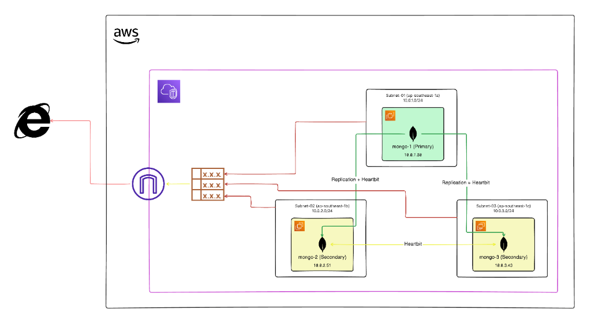
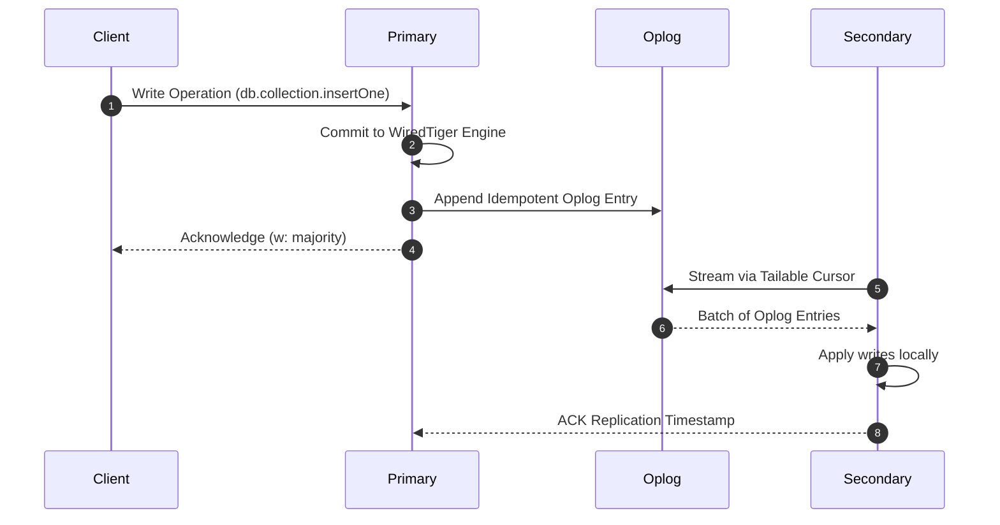
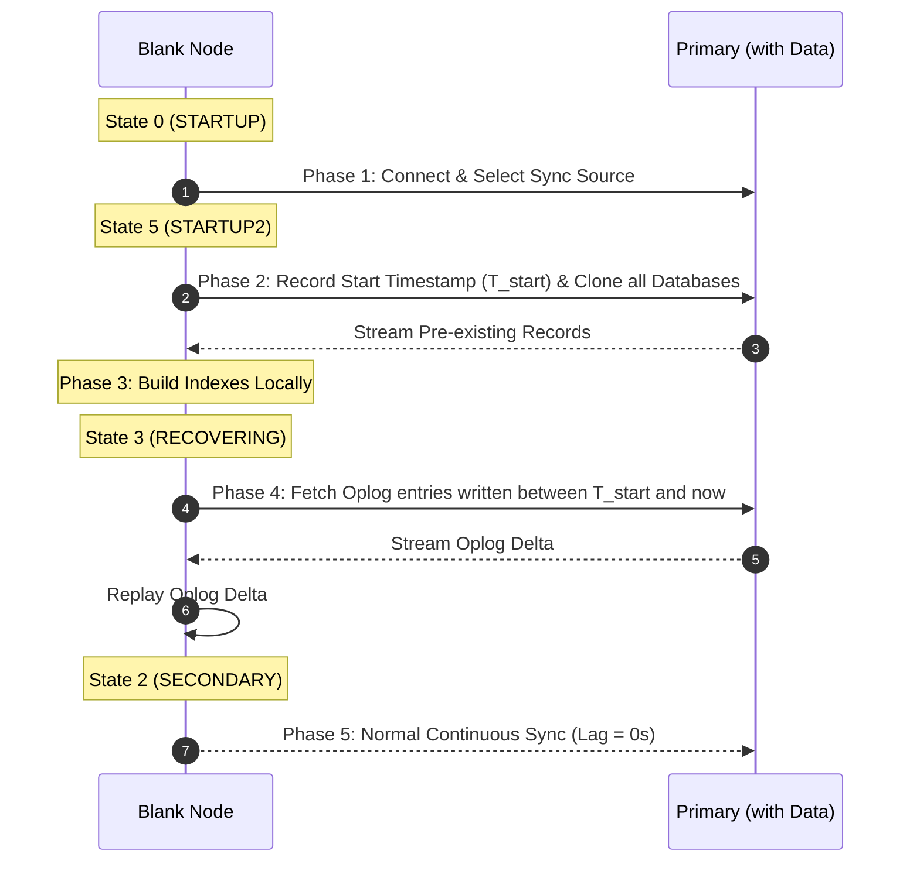

# MongoDB Replica Set Cluster (Automation & Architecture)

Production-grade, highly available 3-node **MongoDB 7.0 Replica Set** deployed across multi-AZ subnets using Ansible.

---

## 1. Prerequisites

### Node Specifications
| Hostname | Role | AWS Subnet / AZ | Private IP | Resources | OS |
| :--- | :--- | :--- | :--- | :--- | :--- |
| `mongo-01` | **PRIMARY** (Priority 2) | Subnet-01 (`ap-southeast-1a`) | `10.0.1.39` | 2 vCPU, 4GB RAM, 20GB SSD | Ubuntu 22.04 / 24.04 |
| `mongo-02` | **SECONDARY** (Priority 1) | Subnet-02 (`ap-southeast-1b`) | `10.0.2.51` | 2 vCPU, 4GB RAM, 20GB SSD | Ubuntu 22.04 / 24.04 |
| `mongo-03` | **SECONDARY** (Priority 1) | Subnet-03 (`ap-southeast-1c`) | `10.0.3.43` | 2 vCPU, 4GB RAM, 20GB SSD | Ubuntu 22.04 / 24.04 |

### SSH Key & Firewall Setup
- **SSH Key Permissions:**
  ```bash
  chmod 600 ~/.ssh/vps1_key.pem ~/.ssh/vps2_key.pem ~/.ssh/vps3_key.pem
  ```
- **Required Ports:**
  - `22/tcp` (SSH management)
  - `27017/tcp` (MongoDB replication, heartbeats, and client traffic)
  ```bash
  sudo ufw allow 22/tcp && sudo ufw allow 27017/tcp && sudo ufw reload
  ```

---

## 2. Architecture



### Core Design Principles
- **Voting Quorum:** $\text{Majority} = \lfloor \frac{N}{2} \rfloor + 1 = \lfloor \frac{3}{2} \rfloor + 1 = 2$. Tolerates 1 node failure without downtime or split-brain.
- **MongoDB 7.0 (Stable):** Chosen over 8.0 for enterprise production stability and testing zero-downtime rolling upgrade paths.
- **Security:** 1024-byte symmetric cluster keyfile (`/etc/mongodb/mongo-keyfile`, mode `0400`) and SCRAM-SHA-256 authentication.
- **Storage & Engine:** WiredTiger with Snappy compression and `local.oplog.rs` circular capped collection buffer.

---

## 3. Deployment Steps & Commands

### Step 1: Configure Inventory (`inventory/hosts.ini`)
```ini
[mongodb_primary]
mongo-01 ansible_host=10.0.1.39 ansible_user=ubuntu ansible_ssh_private_key_file=~/.ssh/vps1_key.pem mongo_member_id=0 mongo_priority=2 mongo_votes=1

[mongodb_secondary]
mongo-02 ansible_host=10.0.2.51 ansible_user=ubuntu ansible_ssh_private_key_file=~/.ssh/vps2_key.pem mongo_member_id=1 mongo_priority=1 mongo_votes=1
mongo-03 ansible_host=10.0.3.43 ansible_user=ubuntu ansible_ssh_private_key_file=~/.ssh/vps3_key.pem mongo_member_id=2 mongo_priority=1 mongo_votes=1

[mongodb_cluster:children]
mongodb_primary
mongodb_secondary
```

Verify SSH connectivity:
```bash
ansible mongodb_cluster -m ping
```

---

### Step 2: Run Full Deployment (One Command)
```bash
ansible-playbook playbooks/site.yml
```

---

### Optional: Step-by-Step Playbook Execution

1. **System Preparation & Kernel Tuning:**
   ```bash
   ansible-playbook playbooks/01_system_prep.yml
   ```
   *Sets `vm.swappiness=1`, `somaxconn=65535`, file descriptors to 100,000, disables Transparent Huge Pages (THP via systemd service), and enables `chrony` NTP.*

2. **Install MongoDB 7.0 & Pin Versions:**
   ```bash
   ansible-playbook playbooks/02_install_mongodb.yml
   ```
   *Adds official MongoDB apt repo, installs `mongodb-org` packages, and locks version via `apt-mark hold`.*

3. **Distribute Keyfile & Configuration:**
   ```bash
   ansible-playbook playbooks/03_configure_mongodb.yml
   ```
   *Generates 1024-byte shared keyfile, distributes to all nodes with `0400` permissions, applies tuned `mongod.conf`, and starts `mongod`.*

4. **Initialize Replica Set & Configure Users:**
   ```bash
   ansible-playbook playbooks/04_init_replicaset.yml
   ```
   *Executes `rs.initiate()` on `mongo-01`, creates `clusterAdmin` and `appUser`, joins `mongo-02` and `mongo-03`, and validates cluster membership.*

---

## 4. Data Replication & Initial Sync Deep Dive

### Continuous Replication Flow


### Initial Sync Protocol (When Master Already Has Data)
When adding a new blank node (`rs.add("mongo-03:27017")`) to a primary with existing records:



> [!NOTE]
> **Zero Data Loss during Initial Sync:** Concurrent writes occurring while databases are cloning are recorded in the Primary's oplog. During the `RECOVERING` phase, the new node replays all delta oplog entries from $T_{\text{start}}$ forward before transitioning to `SECONDARY`.

### Node State Codes
| Code | State Name | Meaning |
| :--- | :--- | :--- |
| `0` | `STARTUP` | Process started, loading config |
| `5` | `STARTUP2` | **Initial Sync active** (cloning data) |
| `3` | `RECOVERING` | Replaying oplog delta |
| `2` | `SECONDARY` | Healthy replica, serving reads |
| `1` | `PRIMARY` | Active master, handling writes |

---

## 5. Testing & Verification

### Test 1: Automated Live Replication Sync
Inserts 50 documents into Primary, waits 3 seconds, and verifies identical document counts on both Secondaries:
```bash
ansible-playbook playbooks/05_test_replication_sync.yml
```

### Test 2: Initial Sync with Pre-existing Data
Inserts 5,000 legacy records on Primary, monitors new replica sync, and verifies the `STARTUP2` $\rightarrow$ `RECOVERING` $\rightarrow$ `SECONDARY` transition:
```bash
ansible-playbook playbooks/06_test_new_member_initial_sync.yml
```

### Test 3: Standalone Verification Scripts
```bash
# Check cluster health and oplog window:
./scripts/verify_cluster.sh <PRIMARY_IP> 27017 clusterAdmin "ClusterAdminSecret2026!"

# Validate live write and read across all nodes:
./scripts/test_data_sync.sh <PRIMARY_IP> <SECONDARY1_IP> <SECONDARY2_IP> 27017

# Simulate initial sync on a newly attached node:
./scripts/simulate_initial_sync.sh <PRIMARY_IP> <NEW_NODE_IP> 27017
```

### Test 4: Automatic Failover & Chaos Drill
1. **Kill Primary:**
   ```bash
   ssh -i ~/.ssh/vps1_key.pem ubuntu@<PRIMARY_IP> "sudo systemctl stop mongod"
   ```
2. **Verify Election on Secondary:**
   ```bash
   mongosh --eval "rs.status().members.forEach(m => print(m.name + ' -> ' + m.stateStr))"
   ```
   *Within 2–3 seconds, one Secondary automatically becomes the new **PRIMARY**.*
3. **Recover Old Primary:**
   ```bash
   ssh -i ~/.ssh/vps1_key.pem ubuntu@<PRIMARY_IP> "sudo systemctl start mongod"
   ```
   *Old Primary rejoins as **SECONDARY** and catches up missed oplog entries.*

---

## 6. Teardown & Reset

To completely purge MongoDB, configurations, data directories, keyfiles, and return instances to a fresh state:
```bash
ansible-playbook playbooks/cleanup.yml
```
