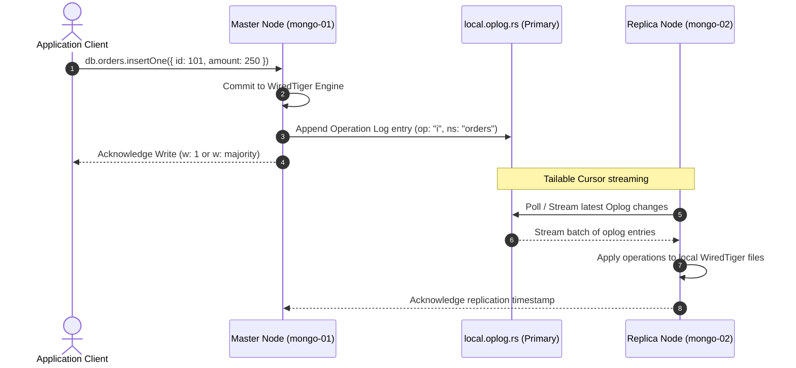
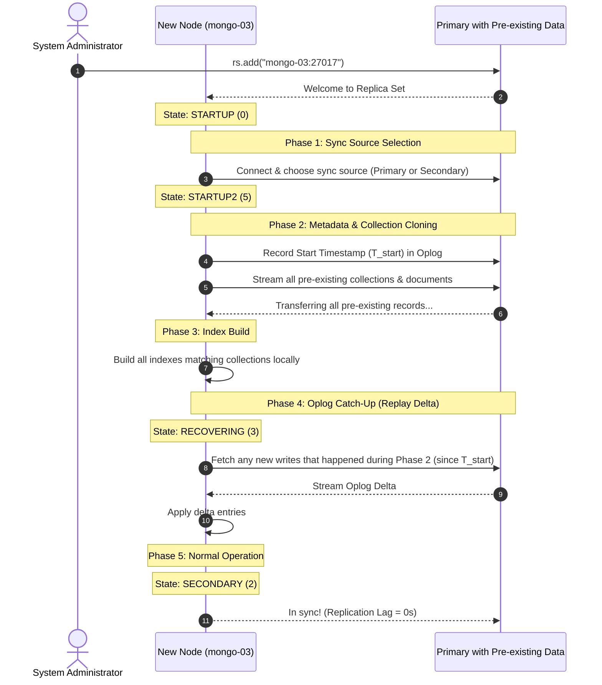

# 04. Data Replication & Initial Sync Deep Dive

এই ডকুমেন্টে বিস্তারিতভাবে ব্যাখ্যা করা হয়েছে কীভাবে MongoDB Primary থেকে Secondary নোডে ডেটা সিঙ্ক করে এবং **মাস্টার ডাটাবেজে আগে থেকে ডেটা থাকলে নতুন রেপ্লিকা যুক্ত করার সাথে সাথে কীভাবে স্বয়ংক্রিয়ভাবে পুরো ডেটা সিঙ্ক হয় (Initial Sync)**।

---

## ১. রেপ্লিকাসেটে স্বাভাবিক ডেটা সিঙ্ক যেভাবে কাজ করে (Continuous Replication)



### Oplog-এর বিশেষ বৈশিষ্ট্য:
1. **Capped Collection:** এটি নির্দিষ্ট আকারের একটি বৃত্তাকার বাফার (Circular buffer)। নতুন ডেটা আসলে পুরোনো ডেটা ক্রমান্বয়ে ওভাররাইট হয়।
2. **আইডেমপোটেন্ট (Idempotent):** অপলগে প্রতিটি অপারেশন এমনভাবে সংরক্ষিত থাকে যাতে একই অপারেশন একাধিকবার অ্যাপ্লাই করলেও চূড়ান্ত ডেটা অবিকল একই থাকে।

---

## ২. মাস্টার নোডে আগে থেকেই ডেটা থাকলে নতুন রেপ্লিকা কীভাবে সিঙ্ক করে? (Initial Sync Protocol)

যদি আপনার Primary-তে পূর্বেই ৫,০০,০০০ রেকর্ড থাকে এবং আপনি সম্পূর্ণ নতুন একটি খালি সার্ভারকে (`mongo-03`) ক্লাস্টারে যোগ করেন:
```javascript
rs.add({ host: "mongo-03:27017" });
```

তখন নিচের সিকোয়েন্স অনুযায়ী স্বয়ংক্রিয় **Initial Sync** শুরু হয়:



---

## ৩. Initial Sync চলাকালীন নতুন রাইট হলে কী হয়?

অনেকের মনে প্রশ্ন জাগে: **"কালেকশন ক্লোন হতে যদি ১০ মিনিট লাগে, আর সেই ১০ মিনিটে প্রাইমারিতে আরও ৫০০০ নতুন রাইট আসে, তাহলে কী ডেটা মিস হবে?"**

উত্তর: **না, এক বিন্দু ডেটাও মিস হয় না।**
1. ক্লোনিং শুরু হওয়ার মুহূর্তে নোডটি প্রাইমারির অপলগের বর্তমান অবস্থান ($T_{\text{start}}$) রেকর্ড করে রাখে।
2. কালেকশন ক্লোন হওয়ার সময় যেসব নতুন রাইট প্রাইমারিতে ঘটে, সেগুলো প্রাইমারির Oplog-এ জমা হতে থাকে।
3. ক্লোন শেষ হওয়া মাত্র নোডটি `RECOVERING` স্টেটে প্রবেশ করে এবং $T_{\text{start}}$ থেকে শুরু করে বর্তমান সময় পর্যন্ত জমা হওয়া সমস্ত Oplog এন্ট্রি রি-প্লে (Replay) করে।
4. যখন ক্যাচ-আপ সম্পূর্ণ হয়, নোডটি স্বয়ংক্রিয়ভাবে `SECONDARY` স্টেটে রূপান্তরিত হয়।

---

## ৪. লাইভ স্ট্যাটাস মনিটরিং ও স্টেট কোড

মঙ্গোডিবি শেলের ভেতরে মেম্বারদের স্টেট কোড নিম্নরূপ দেখা যায়:

| স্টেট কোড | স্টেট নাম | অর্থ |
| :--- | :--- | :--- |
| **0** | `STARTUP` | নোড কেবল শুরু হয়েছে, কনফিগ লোড হচ্ছে। |
| **5** | `STARTUP2` | **Initial Sync রানিং!** ডেটা ক্লোন করা হচ্ছে। |
| **3** | `RECOVERING` | ক্লোন শেষ, অপলগ ডেল্টা ক্যাচ-আপ করা হচ্ছে। |
| **2** | `SECONDARY` | সিঙ্ক সম্পন্ন! নোড সম্পূর্ণ সুস্থ ও রিড করার উপযোগী। |
| **1** | `PRIMARY` | মাস্টার নোড (রাইট গ্রহণকারী)। |

