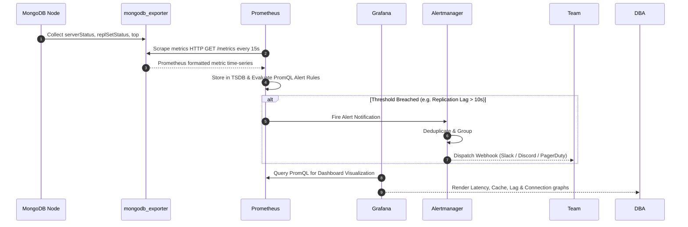

# MongoDB Enterprise Cluster: DB Profiling & Open-Source Monitoring Architecture Plan

## 1. Executive Summary & Strategy Overview

Ei document-e **MongoDB Enterprise Replica Set Cluster** (`rs-prod-01`) er jonno **Database Profiling** ebong **Enterprise-Grade Open-Source Monitoring Stack** implement korar complete blueprint, architecture diagram, tools selection, ebong step-by-step rollout plan describe kora hoyeche.

### Core Objectives:
1. **DB Profiling**: Slow query capture kora without impacting production performance, index miss detect kora (`COLLSCAN`), query execution plan analyze kora.
2. **Cluster Health & Telemetry**: Replica set lag, Oplog window headroom, WiredTiger cache pressure, connection pool saturation track kora.
3. **Host OS Telemetry**: CPU I/O wait, RAM, Disk IOPS, network saturation monitor kora.
4. **Log & Query Analytics**: Real-time log capture ebong query pattern fingerprinting.
5. **Zero-Trust Security Alignment**: Amader existing UFW firewall and SCRAM-SHA-256 RBAC er shathe 100% align rekhe secure metrics scraping setup kora.

---

## 2. Tools Selection & Technology Matrix

Industry-standard, battle-tested, 100% open-source tools use kora hobe:

| Category | Recommended Tool | License | Role & Purpose | Why Selected Over Alternatives |
| :--- | :--- | :--- | :--- | :--- |
| **MongoDB Metrics Exporter** | **`percona/mongodb_exporter`** (v0.40+) | Apache 2.0 | Node-level daemon jeita MongoDB er `serverStatus`, `replSetGetStatus`, `top`, `collStats` scrape kore Prometheus format-e expose kore (Port `9216`). | Official Prometheus exporter er cheye Percona-r exporter active, WiredTiger cache metrics and replication lag accurately expose kore. |
| **Host Metrics Exporter** | **`prometheus/node_exporter`** | Apache 2.0 | OS-level hardware/kernel metrics capture kore: CPU usage, Disk IOPS/latency, RAM, Network (Port `9100`). | Standard CNCF agent; minimal footprint (<15MB RAM). |
| **Time-Series Metric Store** | **Prometheus** (or **VictoriaMetrics**) | Apache 2.0 | Exporter-gulo theke metrics pull/scrape kore time-series database-e store kore ebong PromQL evaluate kore. | Highly scalable, cloud-native standard, zero vendor lock-in. |
| **Visualization & Dashboards** | **Grafana OSS** | AGPLv3 | Unified dashboards for metrics visualization, anomaly detection, ebong drill-down analysis. | Richest ecosystem, Percona MongoDB community dashboards out-of-the-box support kore. |
| **Alerting Engine** | **Prometheus Alertmanager** | Apache 2.0 | Alert de-duplication, grouping, silencing, ebong routing (Slack, Discord, Email, PagerDuty/Webhook). | Native Prometheus integration; robust routing matrix. |
| **Query Log / Log Aggregator** | **Grafana Loki + Promtail** | AGPLv3 / Apache 2.0 | `mongod.log` scrape kore slow query, replica election events, fatal errors Loki-te ingest kore Grafana-te visualize kore. | ElasticSearch/OpenSearch er cheye 80% kom memory/CPU resource use kore. |
| **Offline Profiling & CLI Tool** | **`mtools`** (`mlogfilter`, `mplotqueries`) | Apache 2.0 | Mongod log analyze kore query latency histogram, connection bursts, slow operations breakdown bananor CLI tool. | Ad-hoc post-mortem and root-cause analysis er jonno unbeatable. |

---

## 3. High-Level Architecture Diagram

```mermaid
flowchart TB
    subgraph MultiAZCluster["MongoDB Enterprise Replica Set (rs-prod-01)"]
        direction TB
        
        subgraph Node1["mongo-01 (PRIMARY - 10.0.1.233)"]
            M1["mongod :27017<br/>(Profiling Level 1: slowOp)"]
            ME1["mongodb_exporter :9216"]
            NE1["node_exporter :9100"]
            PT1["promtail agent"]
            M1 -->|Internal Metrics| ME1
            M1 -->|Slow Query Logs| PT1
        end

        subgraph Node2["mongo-02 (SECONDARY - 10.0.2.65)"]
            M2["mongod :27017<br/>(Profiling Level 1: slowOp)"]
            ME2["mongodb_exporter :9216"]
            NE2["node_exporter :9100"]
            PT2["promtail agent"]
            M2 -->|Internal Metrics| ME2
            M2 -->|Slow Query Logs| PT2
        end

        subgraph Node3["mongo-03 (SECONDARY - 10.0.3.167)"]
            M3["mongod :27017<br/>(Profiling Level 1: slowOp)"]
            ME3["mongodb_exporter :9216"]
            NE3["node_exporter :9100"]
            PT3["promtail agent"]
            M3 -->|Internal Metrics| ME3
            M3 -->|Slow Query Logs| PT3
        end
    end

    subgraph MonitoringHost["Monitoring Server (Dedicated Host / Monitoring VPC)"]
        direction TB
        
        Prom["Prometheus Server<br/>(Scrape Interval: 15s)"]
        Loki["Grafana Loki<br/>(Log Ingestion)"]
        AM["Alertmanager<br/>(Alert Evaluation)"]
        Graf["Grafana Server<br/>(Unified Visualizations)"]
        
        Prom -->|Trigger Alerts| AM
        Graf -->|Query Metrics PromQL| Prom
        Graf -->|Query Logs LogQL| Loki
    end

    subgraph AlertChannels["Notification & Incident Response"]
        Slack["Slack / Discord Webhook"]
        Email["Email / PagerDuty"]
    end

    %% Scraping connections (Firewall protected)
    Prom -->|"Scrape :9216 (Auth)"| ME1
    Prom -->|"Scrape :9100"| NE1
    Prom -->|"Scrape :9216 (Auth)"| ME2
    Prom -->|"Scrape :9100"| NE2
    Prom -->|"Scrape :9216 (Auth)"| ME3
    Prom -->|"Scrape :9100"| NE3

    %% Log push connections
    PT1 -->|Push mongod.log| Loki
    PT2 -->|Push mongod.log| Loki
    PT3 -->|Push mongod.log| Loki

    %% Alert routing
    AM --> Slack
    AM --> Email
```



---

## 4. Deep-Dive Strategy 1: DB Profiling Strategy

MongoDB-te database profiling 2 vabe kaj kore:
1. **Engine Level Profiler (`system.profile` capped collection)**
2. **Structured Diagnostic Logging (`mongod.log` slow query entries)**

### 4.1 Profiler Levels & Production Hazards

| Level | Name | Description | Production Safety | Recommendation |
| :--- | :--- | :--- | :--- | :--- |
| `0` | **Off** | Profiler kono operation capture kore na. | Safe, but zero visibility. | Not Recommended. |
| `1` | **Slow Operations Only** | Shudhumatro je shob query `slowOpThresholdMs` cross kore, tader capture kore. | **High (Safe with proper threshold)** | **RECOMMENDED FOR PRODUCTION** |
| `2` | **All Operations** | Prottekta read, write, aggregate operation capture kore. | **EXTREMELY DANGEROUS** (high disk I/O & CPU overhead) | Shudhumatro Dev/Staging short-term debugging-e use korben. |

### 4.2 Production Profiling Configuration (`mongod.conf`)

Cluster-er `mongod.conf.j2` file-e profiling tuning:

```yaml
operationProfiling:
  mode: slowOp               # Level 1: Only slow queries
  slowOpThresholdMs: 100     # Threshold in ms (100ms standard, intensive workloads: 50ms)
  slowOpSampleRate: 1.0      # 1.0 = 100% of slow queries. Ultra-high write clusters-e 0.2 (20%) use kora hoy
  filter: '{ "op": { "$in": [ "query", "command", "update", "remove" ] } }'
```

### 4.3 Profiling Collection (`system.profile`) Management Strategy

By default `system.profile` capped collection 1MB hoy. High-throughput cluster-e 1MB khub druto overwrite hoye jay. Production standard practice:
- Size expand kora to **50MB - 100MB**:
```javascript
// mongosh admin shell
use ecommerce_db;
db.setProfilingLevel(0); // Off first to reallocate
db.system.profile.drop();
db.createCollection("system.profile", { capped: true, size: 52428800 }); // 50MB
db.setProfilingLevel(1, { slowms: 100, sampleRate: 1.0 });
```

### 4.4 Top Profiling Queries (Runbook)

1. **Find Slowest Queries in the Last 1 Hour:**
```javascript
use ecommerce_db;
db.system.profile.find({
  ts: { $gt: new Date(Date.now() - 60 * 60 * 1000) }
}).sort({ millis: -1 }).limit(5).pretty();
```

2. **Detect Missing Indexes (`COLLSCAN`):**
```javascript
db.system.profile.find({
  "planSummary": "COLLSCAN",
  "op": { $in: ["query", "update", "remove"] }
}).projection({
  ns: 1,
  "command.filter": 1,
  docsExamined: 1,
  nreturned: 1,
  millis: 1
}).sort({ millis: -1 }).limit(10);
```
> **Rule of Thumb**: Jodi `docsExamined / nreturned` ratio > 100 hoy, tar mane missing/poor index ache!

3. **Check Lock Waiting Latency:**
```javascript
db.system.profile.find({
  "locks.Global.timeAcquiringMicros": { $gt: 100000 } // > 100ms waiting for lock
}).sort({ ts: -1 }).limit(5);
```

---

## 5. Deep-Dive Strategy 2: Open-Source DB Monitoring Strategy

### 5.1 Architecture Components



### 5.2 The 5 Golden Signal Categories for MongoDB

#### Category 1: Replication & Cluster Health (Highest Priority)
- **Metric**: `mongodb_mongod_replset_member_replication_lag`
  - *Threshold*: Secondary lag $> 10\text{s}$ (Warning), $> 30\text{s}$ (Critical).
- **Metric**: `mongodb_mongod_replset_oplog_headroom`
  - *Threshold*: Oplog remaining window $< 24\text{ hours}$. Secondary jeno Oplog overwrite er karone out-of-sync na hoy!
- **Metric**: `mongodb_mongod_replset_member_state`
  - *State Check*: Ensure exactly 1 PRIMARY and $(N-1)$ SECONDARY nodes exist.

#### Category 2: WiredTiger Storage Engine Health
- **Metric**: `mongodb_mongod_wiredtiger_cache_used_bytes` vs `max_bytes`
  - *Warning*: Cache usage $> 80\%$.
- **Metric**: `mongodb_mongod_wiredtiger_cache_dirty_bytes`
  - *Critical*: Dirty data in cache $> 20\%$. (WiredTiger stops user writes to flush dirty pages to disk, causing latency spikes!).
- **Metric**: `mongodb_mongod_wiredtiger_cache_pages_evicted_rate`
  - *Insight*: Eviction rate abnormal hole memory starvation ache.

#### Category 3: Client Connections & Queue Saturation
- **Metric**: `mongodb_mongod_connections{state="current"}`
  - *Threshold*: $> 80\%$ of `maxIncomingConnections` (amader config: 64,000).
- **Metric**: `mongodb_mongod_global_lock_current_queue{type="reader|writer"}`
  - *Threshold*: Queued read/write requests $> 20$. Indicative of query stall or storage bottleneck.

#### Category 4: Query Throughput & Latency
- **Metric**: `rate(mongodb_mongod_op_counters_total[1m])` (insert, update, delete, query, getmore, command).
- **Metric**: `mongodb_mongod_op_latencies_latency_total` / operations count (Real-time P95/P99 latency).

#### Category 5: Host OS & Storage Hardware
- **Metric**: `node_disk_io_time_seconds_total` (Disk Utilization % and I/O wait).
- **Metric**: `node_memory_MemAvailable_bytes` and Swap usage.
- **Metric**: `node_cpu_seconds_total{mode="iowait"}` ($> 15\%$ means disk storage is throttling database).

---

## 6. Security & Firewall Architecture for Monitoring

Amader cluster-e **UFW Default-Deny Firewall** and **SCRAM-SHA-256 Authentication** chalu ache. Tai monitoring add korle security compromise kora jabe na:

### 6.1 Dedicated RBAC User for Exporter
Prometheus exporter-er jonno dedicated least-privilege user create kora hobe:

```javascript
// mongosh (Run on Primary node)
use admin;
db.createUser({
  user: "mongodb_exporter",
  pwd: "ExporterSecretPassword2026!",
  roles: [
    { role: "clusterMonitor", db: "admin" },
    { role: "read", db: "local" }
  ]
});
```

### 6.2 Linux Kernel UFW Rules for Monitoring Ports
Only the Prometheus Server IP (`MONITORING_SERVER_IP`) ke allow kora hobe:
- Port `9216` (`mongodb_exporter`)
- Port `9100` (`node_exporter`)

```bash
# Allow only Prometheus Server
sudo ufw allow proto tcp from <MONITORING_SERVER_IP> to any port 9216 comment "Allow Prometheus to MongoDB Exporter"
sudo ufw allow proto tcp from <MONITORING_SERVER_IP> to any port 9100 comment "Allow Prometheus to Node Exporter"
```

---

## 7. Step-by-Step Implementation & Automation Plan

### Phase 1: Profiling Tuning (Day 1)
- `mongod.conf.j2` file-e `operationProfiling` update kora (`slowOp`, `slowOpThresholdMs: 100`, `slowOpSampleRate: 1.0`).
- Rolling restart or runtime apply:
  `db.setProfilingLevel(1, { slowms: 100, sampleRate: 1.0 })` across all 3 nodes.
- Capped collection size resize kora to 50MB.

### Phase 2: Host & DB Exporters Provisioning (Day 2)
- Create new Ansible playbook: `playbooks/12_install_monitoring_agents.yml`.
- Automate installation of:
  1. `node_exporter` (systemd service).
  2. `mongodb_exporter` (configured with `mongodb_exporter` user URI, systemd service).
- UFW firewall rules automated via Ansible `ufw` module.

### Phase 3: Prometheus & Grafana Stack Setup (Day 3)
- Dedicated Monitoring Node-e Docker Compose or systemd stack:
  - `prometheus` configured with scrape targets: `mongo-01:9216`, `mongo-02:9216`, `mongo-03:9216`, `mongo-01:9100`, etc.
  - `alertmanager` configured with Alert rules.
  - `grafana` with imported community dashboards:
    - **Percona MongoDB Dashboard (ID: 14997 or Percona PMM Dashboard)**
    - **Node Exporter Full (ID: 1860)**

### Phase 4: Query Log Analytics with Loki & Promtail (Day 4)
- Install Promtail on all 3 MongoDB nodes.
- Ship `/var/log/mongodb/mongod.log` to central Loki instance.
- Grafana Explore dashboard-e live slow query stream visualize kora.

### Phase 5: Production Verification & Testing (Day 5)
- Synthetic slow query generate kora (`sleep` or unindexed query on `ecommerce_db`).
- Verify alert firing on Alertmanager/Slack.
- Document runbooks and on-call escalation policies.

---

## 8. Ready-to-Use Ansible Playbook Blueprint

Niche amader existing repo structure-er shathe 100% compatible Ansible playbook blueprint deya holo:

```yaml
---
# ==============================================================================
# playbooks/12_install_monitoring_agents.yml
# Installs node_exporter and percona/mongodb_exporter as Systemd Daemons
# ==============================================================================
- name: Deploy Open-Source Monitoring Agents to MongoDB Cluster
  hosts: mongodb_cluster
  become: true
  vars:
    node_exporter_version: "1.7.0"
    mongodb_exporter_version: "0.40.0"
    exporter_mongo_user: "mongodb_exporter"
    exporter_mongo_password: "{{ mongo_exporter_password | default('ExporterSecretPassword2026!') }}"
    monitoring_server_ip: "10.0.0.100" # Set your Prometheus Server IP

  tasks:
    - name: Create dedicated system user for exporters
      ansible.builtin.user:
        name: prometheus
        system: true
        shell: /usr/sbin/nologin

    # 1. Install Node Exporter
    - name: Download node_exporter binary
      ansible.builtin.get_url:
        url: "https://github.com/prometheus/node_exporter/releases/download/v{{ node_exporter_version }}/node_exporter-{{ node_exporter_version }}.linux-amd64.tar.gz"
        dest: /tmp/node_exporter.tar.gz
        mode: '0644'

    - name: Extract node_exporter
      ansible.builtin.unarchive:
        src: /tmp/node_exporter.tar.gz
        dest: /tmp/
        remote_src: true

    - name: Move node_exporter binary to /usr/local/bin
      ansible.builtin.copy:
        src: "/tmp/node_exporter-{{ node_exporter_version }}.linux-amd64/node_exporter"
        dest: /usr/local/bin/node_exporter
        mode: '0755'
        remote_src: true

    - name: Create Systemd service for node_exporter
      ansible.builtin.copy:
        dest: /etc/systemd/system/node_exporter.service
        content: |
          [Unit]
          Description=Node Exporter
          Wants=network-online.target
          After=network-online.target

          [Service]
          User=prometheus
          ExecStart=/usr/local/bin/node_exporter --collector.systemd --collector.processes
          Restart=always

          [Install]
          WantedBy=multi-user.target

    # 2. Install MongoDB Exporter (Percona)
    - name: Download percona mongodb_exporter binary
      ansible.builtin.get_url:
        url: "https://github.com/percona/mongodb_exporter/releases/download/v{{ mongodb_exporter_version }}/mongodb_exporter-{{ mongodb_exporter_version }}.linux-amd64.tar.gz"
        dest: /tmp/mongodb_exporter.tar.gz
        mode: '0644'

    - name: Extract mongodb_exporter
      ansible.builtin.unarchive:
        src: /tmp/mongodb_exporter.tar.gz
        dest: /tmp/
        remote_src: true

    - name: Move mongodb_exporter binary to /usr/local/bin
      ansible.builtin.copy:
        src: "/tmp/mongodb_exporter-{{ mongodb_exporter_version }}.linux-amd64/mongodb_exporter"
        dest: /usr/local/bin/mongodb_exporter
        mode: '0755'
        remote_src: true

    - name: Create Systemd service for mongodb_exporter
      ansible.builtin.copy:
        dest: /etc/systemd/system/mongodb_exporter.service
        content: |
          [Unit]
          Description=Percona MongoDB Exporter
          Wants=network-online.target
          After=network-online.target

          [Service]
          User=prometheus
          Environment="MONGODB_URI=mongodb://{{ exporter_mongo_user }}:{{ exporter_mongo_password }}@127.0.0.1:{{ mongo_port }}/admin?authSource=admin"
          ExecStart=/usr/local/bin/mongodb_exporter --dis_collstats --compatible-mode
          Restart=always

          [Install]
          WantedBy=multi-user.target

    # 3. Reload systemd and start services
    - name: Enable and start monitoring services
      ansible.builtin.systemd:
        name: "{{ item }}"
        daemon_reload: true
        state: started
        enabled: true
      loop:
        - node_exporter
        - mongodb_exporter

    # 4. Enforce UFW access rules
    - name: Allow Prometheus server to access node_exporter (9100)
      community.general.ufw:
        rule: allow
        proto: tcp
        from_ip: "{{ monitoring_server_ip }}"
        port: '9100'
        comment: "Prometheus Node Exporter access"

    - name: Allow Prometheus server to access mongodb_exporter (9216)
      community.general.ufw:
        rule: allow
        proto: tcp
        from_ip: "{{ monitoring_server_ip }}"
        port: '9216'
        comment: "Prometheus MongoDB Exporter access"
```

---

## 9. Prometheus Alert Rules Configuration

Niche standard Prometheus alerting rules file (`alerts/mongodb_rules.yml`):

```yaml
groups:
  - name: mongodb_alerts
    rules:
      - alert: MongoDBNodeDown
        expr: mongodb_up == 0
        for: 1m
        labels:
          severity: critical
        annotations:
          summary: "MongoDB Node Down (Instance {{ $labels.instance }})"
          description: "MongoDB instance {{ $labels.instance }} is unreachable."

      - alert: ReplicationLagHigh
        expr: mongodb_mongod_replset_member_replication_lag > 15
        for: 2m
        labels:
          severity: warning
        annotations:
          summary: "Replication Lag high on {{ $labels.instance }}"
          description: "Secondary {{ $labels.instance }} has replication lag > 15 seconds."

      - alert: OplogHeadroomLow
        expr: mongodb_mongod_replset_oplog_headroom < 12
        for: 15m
        labels:
          severity: critical
        annotations:
          summary: "Oplog Headroom critically low"
          description: "Remaining Oplog retention window is less than 12 hours!"

      - alert: WiredTigerDirtyCacheHigh
        expr: (mongodb_mongod_wiredtiger_cache_dirty_bytes / mongodb_mongod_wiredtiger_cache_max_bytes) * 100 > 20
        for: 2m
        labels:
          severity: critical
        annotations:
          summary: "WiredTiger dirty cache > 20%"
          description: "Storage write stall imminent on {{ $labels.instance }}."

      - alert: HighConnectionSaturation
        expr: (mongodb_mongod_connections{state="current"} / 64000) * 100 > 80
        for: 5m
        labels:
          severity: warning
        annotations:
          summary: "Connection pool > 80% capacity on {{ $labels.instance }}"
          description: "Incoming connections approaching limit."
```

---

## 10. Summary & Recommendation

1. **DB Profiling**:
   - `mongod.conf` e `mode: slowOp`, `slowOpThresholdMs: 100`, `slowOpSampleRate: 1.0` set korun.
   - `system.profile` capped collection 50MB te size korun.
   - Slow queries analyze korar jonno `planSummary: COLLSCAN` query runbook use korun.

2. **Open-Source Monitoring**:
   - **Prometheus + Percona `mongodb_exporter` + `node_exporter` + Grafana + Alertmanager** stack deploy korun.
   - Port `9216` and `9100` ke strictly firewall (UFW)-e only Prometheus host IP er jonno allow korun.
   - Key alerts monitor korun: Replication Lag, Oplog Headroom, WiredTiger dirty cache, and Node availability.

