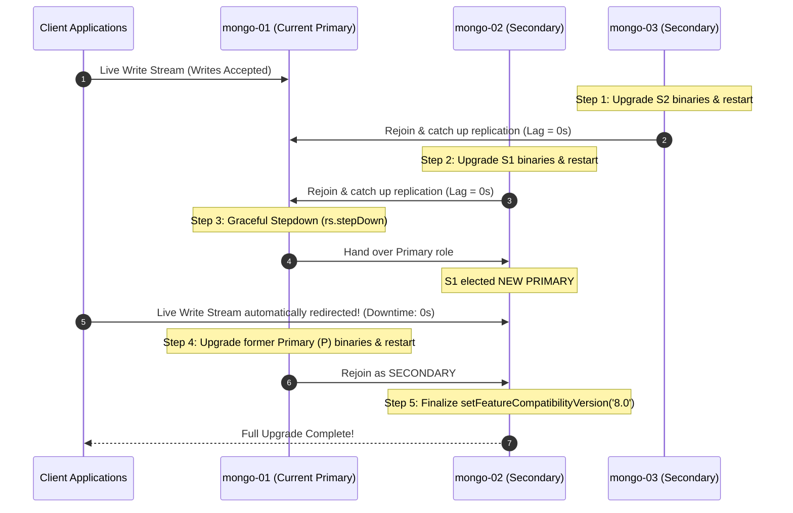

# MongoDB Enterprise Replica Set Cluster
### High Availability, Network Access Control, Automated Backups & Zero-Downtime Rolling Migrations

An enterprise-ready, fully automated **MongoDB 7.0 / 8.0 Multi-AZ Replica Set** deployment managed via Ansible.

---

## 1. Key Enterprise Features

| Feature | Description | Reference / Playbook |
| :--- | :--- | :--- |
| **High Availability (HA)** | 3-node multi-AZ architecture with automatic failover ($\leq 3\text{s}$) and quorum consensus. | [`playbooks/04_init_replicaset.yml`](playbooks/04_init_replicaset.yml) |
| **Application Server Binding** | Restricts MongoDB port `27017` to authorized application servers and internal cluster nodes only. Unauthorized IPs are strictly blocked. | [`playbooks/05_setup_firewall_access.yml`](playbooks/05_setup_firewall_access.yml) |
| **Automated Backups** | Periodic scheduled backups on Secondary node via systemd timer/cron with `--oplog` consistency, SHA-256 checksums, and retention pruning. | [`playbooks/06_setup_automated_backups.yml`](playbooks/06_setup_automated_backups.yml) |
| **On-Demand Manual Backups** | Instant point-in-time snapshot triggerable via CLI script or Ansible at any time. | [`playbooks/07_trigger_manual_backup.yml`](playbooks/07_trigger_manual_backup.yml) |
| **Disaster Recovery (DR) & PITR** | Comprehensive disaster recovery with Point-In-Time-Recovery (PITR) oplog replay up to the second before data loss or accidental deletion. | [`playbooks/08_restore_disaster_recovery.yml`](playbooks/08_restore_disaster_recovery.yml) |
| **Zero-Downtime Rolling Upgrade** | Seamless version upgrades (e.g., 7.0 $\rightarrow$ 8.0) via sequential secondary upgrades, primary stepdown, and FCV finalization with 0 application downtime. | [`playbooks/09_rolling_upgrade.yml`](playbooks/09_rolling_upgrade.yml) |

---

## 2. Cluster Architecture & Network Topology

```mermaid
graph TB
    subgraph ClientLayer["Authorized Application Servers (Allowed Only)"]
        App1["App Server 1 (API Gateway)<br/>10.0.10.15"]
        App2["App Server 2 (Worker)<br/>10.0.10.16"]
        AppSubnet["Microservices Subnet<br/>10.0.20.0/24"]
    end

    subgraph BlockedZone["Unauthorized External Traffic"]
        PublicAttacker["Unauthorized Internet IP"]
    end

    subgraph Cluster["MongoDB Enterprise Cluster (Multi-AZ)"]
        subgraph Node1["mongo-01 (Priority 2) - ap-southeast-1a"]
            FW1["Kernel Firewall (UFW)"]
            DB1["mongod :27017<br/>Role: PRIMARY"]
        end

        subgraph Node2["mongo-02 (Priority 1) - ap-southeast-1b"]
            FW2["Kernel Firewall (UFW)"]
            DB2["mongod :27017<br/>Role: SECONDARY<br/>🕒 Automated Backup Engine"]
        end

        subgraph Node3["mongo-03 (Priority 1) - ap-southeast-1c"]
            FW3["Kernel Firewall (UFW)"]
            DB3["mongod :27017<br/>Role: SECONDARY<br/>🛡️ DR Replica"]
        end
    end

    PublicAttacker -.->|Port 27017: DROPPED ❌| FW1
    PublicAttacker -.->|Port 27017: DROPPED ❌| FW2

    App1 ==>|Allowed Port 27017 ✅ (Writes)| FW1
    App2 ==>|Allowed Port 27017 ✅ (Writes)| FW1
    AppSubnet ==>|Allowed Port 27017 ✅ (Reads)| FW2
    AppSubnet ==>|Allowed Port 27017 ✅ (Reads)| FW3

    DB1 <==>|Internal Sync & Heartbeats :27017| DB2
    DB2 <==>|Internal Sync & Heartbeats :27017| DB3
    DB1 <==>|Internal Sync & Heartbeats :27017| DB3
```

---

## 3. Node Inventory & Prerequisites

### Cluster Nodes
| Hostname | Role | Subnet / AZ | Private IP | Resources | OS |
| :--- | :--- | :--- | :--- | :--- | :--- |
| `mongo-01` | **PRIMARY** (Priority 2) | Subnet-01 (`ap-southeast-1a`) | `10.0.1.30` | 2 vCPU, 4GB RAM, 20GB SSD | Ubuntu 22.04 / 24.04 |
| `mongo-02` | **SECONDARY** (Priority 1, Backups) | Subnet-02 (`ap-southeast-1b`) | `10.0.2.51` | 2 vCPU, 4GB RAM, 20GB SSD | Ubuntu 22.04 / 24.04 |
| `mongo-03` | **SECONDARY** (Priority 1, DR) | Subnet-03 (`ap-southeast-1c`) | `10.0.3.43` | 2 vCPU, 4GB RAM, 20GB SSD | Ubuntu 22.04 / 24.04 |

### SSH Key Permissions
Ensure keys are chmod 400 / 600:
```bash
chmod 600 keys/MyKeyPair.pem
```

---

## 4. Quickstart Deployment (Single Master Command)

To provision the full enterprise cluster from scratch (system tuning, packages, keyfiles, replica set initialization, firewall server binding, automated backup schedules, and replication test):

```bash
cd mongodb-enterprise-cluster
ansible-playbook playbooks/site.yml
```

---

## 5. Feature Execution Guide

### Feature A: Bind Database Access to Specific Application Servers
To restrict MongoDB port `27017` to specific application servers and internal cluster nodes:
1. Open [`inventory/group_vars/all.yml`](inventory/group_vars/all.yml) and configure your allowed application servers:
   ```yaml
   firewall_access_control_enabled: true
   mongo_allowed_app_clients:
     - "10.0.10.15"       # App Server 1 (API Gateway)
     - "10.0.10.16"       # App Server 2 (Background Worker)
     - "10.0.20.0/24"     # Microservices Subnet
   ```
2. Apply the firewall configuration:
   ```bash
   ansible-playbook playbooks/05_setup_firewall_access.yml
   ```
3. Test network access:
   ```bash
   # From an allowed client:
   ./scripts/test_client_access.sh 10.0.1.30 27017
   # => Output: ✅ ACCESS GRANTED

   # From an unauthorized client / internet IP:
   ./scripts/test_client_access.sh 10.0.1.30 27017
   # => Output: 🛑 ACCESS DENIED / BLOCKED
   ```
*Detailed guide:* [`docs/FIREWALL_ACCESS_CONTROL.md`](docs/FIREWALL_ACCESS_CONTROL.md)

---

### Feature B: Automated Backups & Manual Trigger
Backups are executed on `mongo-02` (Secondary) with `--oplog` transactional consistency, SHA-256 validation, and automatic 7-day retention cleanup.

#### 1. Setup / Update Automated Backup Schedule
```bash
ansible-playbook playbooks/06_setup_automated_backups.yml
```
*Schedule runs daily at 02:00:00 UTC via systemd timer `mongodb-backup.timer`.*

#### 2. Trigger an Immediate Manual Backup
```bash
# Using CLI script:
./scripts/trigger_backup.sh

# Or with Ansible (and download archive locally):
ansible-playbook playbooks/07_trigger_manual_backup.yml -e "fetch_to_controller=true"
```
*Backups are saved to `/var/backups/mongodb/mongo_backup_<TIMESTAMP>.archive.gz`.*

---

### Feature C: Disaster Recovery (DR) & Point-In-Time-Recovery (PITR)
What happens if data is accidentally deleted or hardware is destroyed?

#### Scenario 1: Automatic Failover (Node Crash)
If the Primary goes offline:
- Secondaries elect a new Primary in $\leq 3$ seconds.
- Applications with modern connection strings (`retryWrites=true`) experience zero data loss.
- When the crashed node recovers, it automatically replays missed oplog entries.

#### Scenario 2: Point-In-Time-Recovery (Accidental Deletion / Human Error)
If a collection is dropped at timestamp $T_{\text{drop}}$:
```bash
# Restore latest backup and replay oplog stopping right before T_drop:
ansible-playbook playbooks/08_restore_disaster_recovery.yml \
  -e "restore_oplog_limit='1712839200:1' restore_drop=true"
```

#### Scenario 3: Full Disaster Recovery Restore
To restore all databases from the latest archive snapshot:
```bash
ansible-playbook playbooks/08_restore_disaster_recovery.yml
```
*Detailed guide:* [`docs/BACKUP_AND_DISASTER_RECOVERY.md`](docs/BACKUP_AND_DISASTER_RECOVERY.md)

---

### Feature D: Zero-Downtime Rolling Version Upgrade (e.g. 7.0 $\rightarrow$ 8.0)
Upgrade all cluster nodes to a new major/minor version with **zero downtime**:



To execute the automated rolling upgrade:
```bash
ansible-playbook playbooks/09_rolling_upgrade.yml \
  -e "target_upgrade_version=8.0 target_feature_compatibility_version=8.0"
```
*Detailed guide:* [`docs/ZERO_DOWNTIME_MIGRATION.md`](docs/ZERO_DOWNTIME_MIGRATION.md)

---

## 6. Testing & Validation

### 1. Replica Set Health & Status Check
```bash
./scripts/verify_cluster.sh <PRIMARY_IP> 27017 clusterAdmin "ClusterAdminSecret2026!"
```

### 2. Live Replication Sync Test
Inserts 50 documents into Primary and asserts secondaries replicate them in $< 2$ seconds:
```bash
ansible-playbook playbooks/10_test_replication_sync.yml
```

### 3. Application Driver Read/Write Split & Failover Test
Run the Node.js test client inside `test-app/`:
```bash
cd test-app
npm install
npm test
```
To run continuous write streaming while testing failover or rolling upgrade:
```bash
npm run resilience
```

---

## 7. Teardown & Reset

To completely wipe all MongoDB installations, backups, firewall rules, and keyfiles for a clean state:
```bash
ansible-playbook playbooks/99_teardown_cluster.yml
```

