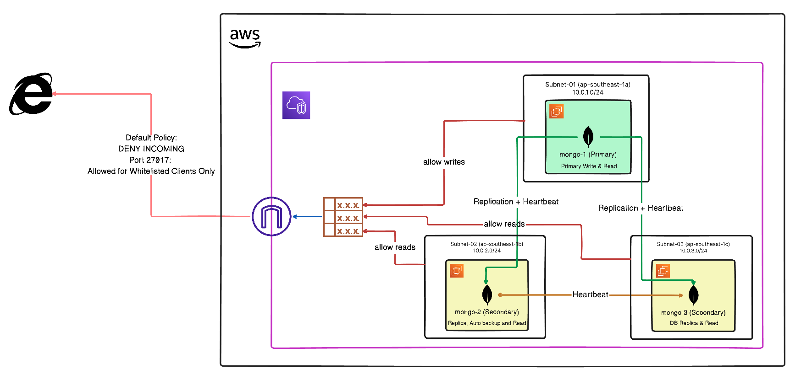
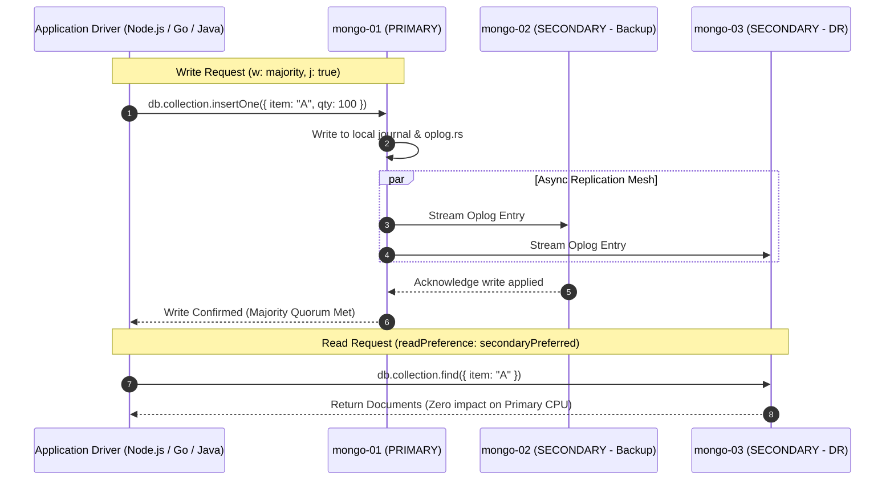
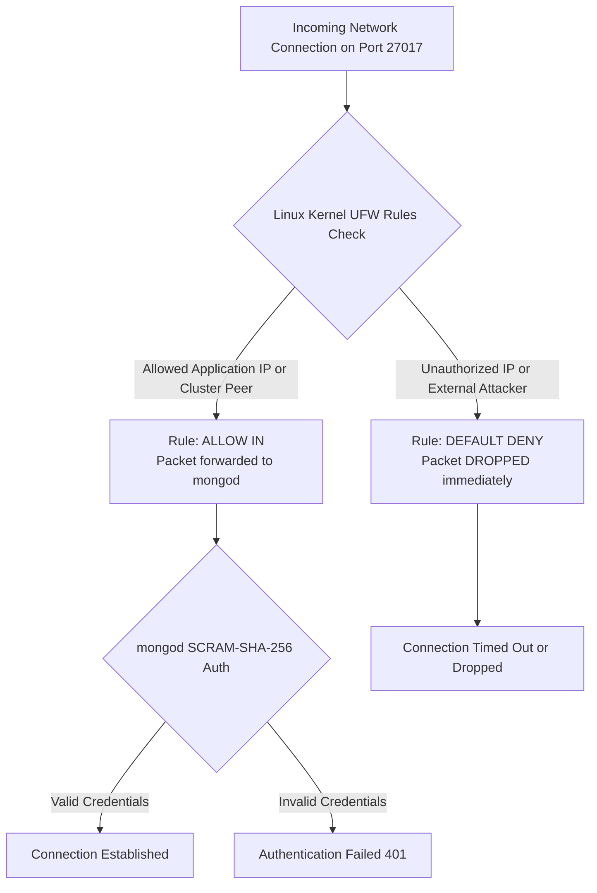
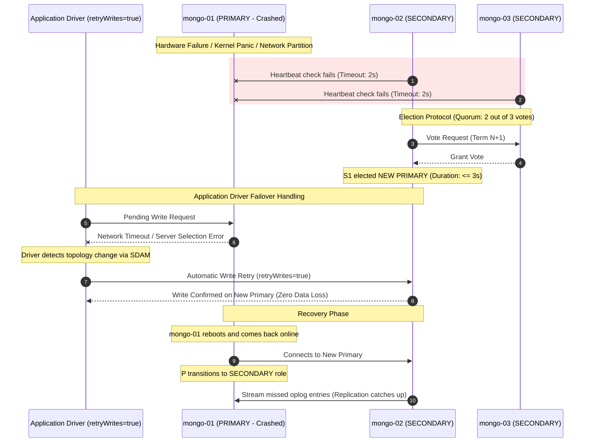
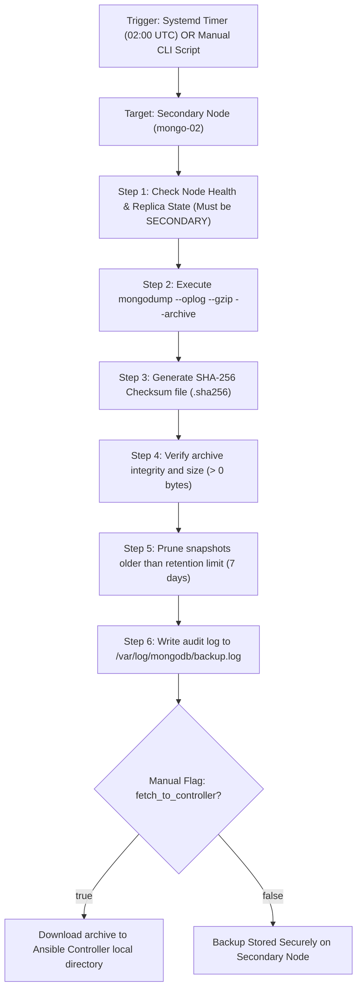
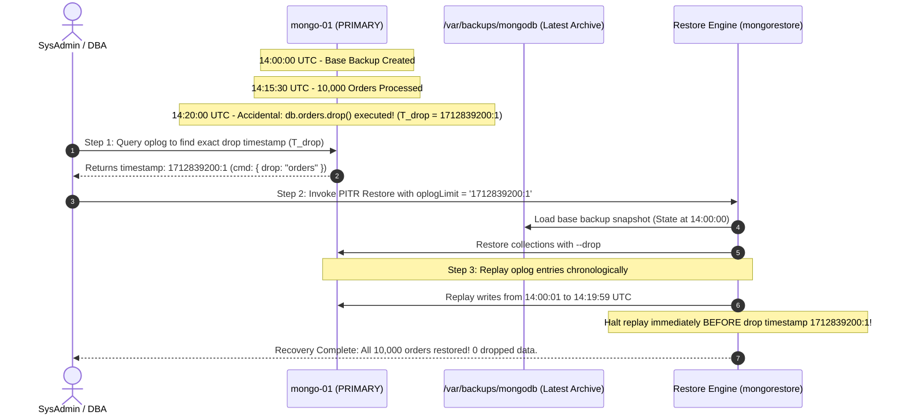
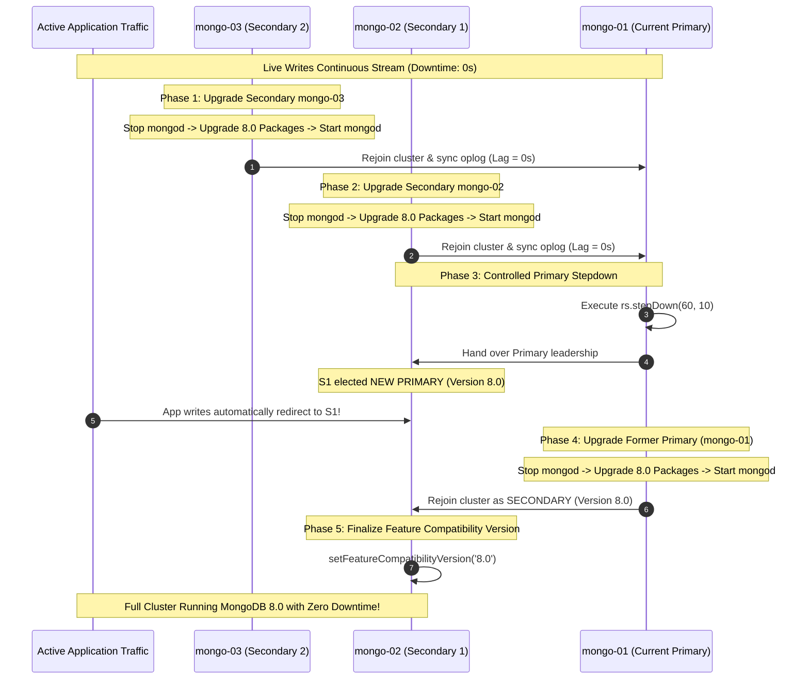

# MongoDB Enterprise Replica Set Cluster
### High Availability, Network Access Control, Automated Backups, PITR & Zero-Downtime Rolling Upgrades

An enterprise-grade, fully automated **MongoDB 7.0 / 8.0 Multi-AZ Replica Set** deployment and lifecycle management framework powered by Ansible.

---

## 1. Enterprise Feature Matrix

| Feature | Technical Mechanism | Benefit | Reference Playbook / Script |
| :--- | :--- | :--- | :--- |
| **High Availability & Auto-Failover** | 3-node distributed consensus with election timeout $\le 2\text{s}$ and failover $\le 3\text{s}$. | Continuous database availability during AZ outage or hardware failure without manual intervention. | [`playbooks/04_init_replicaset.yml`](playbooks/04_init_replicaset.yml) |
| **Application Server Binding** | Linux Kernel Firewall (`UFW`) default-deny policy with strict IP/CIDR allowlisting for port `27017`. | MongoDB is completely unreachable from the public internet; only authorized application servers and peer nodes can connect. | [`playbooks/05_setup_firewall_access.yml`](playbooks/05_setup_firewall_access.yml)<br>[`scripts/test_client_access.sh`](scripts/test_client_access.sh) |
| **Enterprise Authentication & RBAC** | SCRAM-SHA-256 user authentication paired with a shared 1024-bit cluster keyfile for internal node mesh encryption. | Prevents unauthorized command execution and secures intra-cluster replication traffic. | [`playbooks/03_configure_mongodb.yml`](playbooks/03_configure_mongodb.yml)<br>[`playbooks/04_init_replicaset.yml`](playbooks/04_init_replicaset.yml) |
| **Secondary-Targeted Automated Backups** | Systemd Timer executes scheduled `mongodump` with `--oplog` on designated Secondary (`mongo-02`) with gzip compression and SHA-256 verification. | 100% consistent transactional snapshots with **zero I/O hit** on the Primary node. Automatic 7-day retention cleanup. | [`playbooks/06_setup_automated_backups.yml`](playbooks/06_setup_automated_backups.yml) |
| **On-Demand Manual Snapshots** | Immediate point-in-time snapshot triggerable on-demand with optional download to the Ansible controller. | Pre-deployment safekeeping and compliance archive generation. | [`playbooks/07_trigger_manual_backup.yml`](playbooks/07_trigger_manual_backup.yml)<br>[`scripts/trigger_backup.sh`](scripts/trigger_backup.sh) |
| **Disaster Recovery & Granular PITR** | `mongorestore` paired with oplog replaying up to a specific timestamp (`--oplogLimit='sec:inc'`). | Instant point-in-time recovery to the second right before accidental `dropDatabase` or data corruption. | [`playbooks/08_restore_disaster_recovery.yml`](playbooks/08_restore_disaster_recovery.yml)<br>[`scripts/restore_pitr.sh`](scripts/restore_pitr.sh) |
| **Zero-Downtime Rolling Upgrades** | Sequential node-by-node binary upgrades ($7.0 \rightarrow 8.0$), controlled Primary stepdown (`rs.stepDown`), and FCV finalization. | Version upgrades without application interruption or query downtime. | [`playbooks/09_rolling_upgrade.yml`](playbooks/09_rolling_upgrade.yml)<br>[`scripts/rolling_upgrade_check.sh`](scripts/rolling_upgrade_check.sh) |
| **Cross-VPC / Remote Node Reconfiguration** | Automated dynamic replica set reconfiguration supporting public WAN IPs and multi-cloud nodes. | Seamless connection when application servers reside in external VPCs or different cloud providers. | [`playbooks/reconfig_public_ips.yml`](playbooks/reconfig_public_ips.yml) |
| **Automated Replication Verification** | Automated document injection on Primary with assertion of secondary propagation in $< 2\text{s}$. | Guarantees replication health and validates replication lag across all nodes. | [`playbooks/10_test_replication_sync.yml`](playbooks/10_test_replication_sync.yml)<br>[`scripts/verify_cluster.sh`](scripts/verify_cluster.sh) |
| **Resilience & Failover Test Suite** | Production Node.js client harness for read/write splitting, continuous write resilience, and PITR validation. | End-to-end driver-level testing under real application traffic conditions. | [`test-app/`](test-app/) |

---

## 2.  System Architecture



---

## 3. Situation-Based Operational Workflows

### Situation 1: Normal Operations & Read/Write Splitting
In healthy state, client applications distribute load automatically between the Primary and Secondaries using driver-level read preference.



**How the System Handles This:**
1. All database writes are strictly routed to `mongo-01` (Primary).
2. The Primary replicates data asynchronously to `mongo-02` and `mongo-03` via `local.oplog.rs`.
3. Read operations targeting `secondaryPreferred` are load-balanced across Secondaries, ensuring near-zero CPU and memory contention on the Primary.

---

### Situation 2: Network Access Control & Intrusion Blocking
Database port `27017` is tightly bound so that unauthorized external IPs cannot discover, probe, or connect to the database.



**How the System Handles This:**
1. **Kernel-Level Enforcement:** Linux `ufw` sets a default incoming policy of `deny`.
2. **Explicit Allow Rules:** Only the IPs/CIDRs configured in `mongo_allowed_app_clients` and the internal cluster IPs are granted access to port `27017`.
3. **Internal Keyfile Mesh:** Intra-cluster replication requires mutual 1024-bit keyfile authentication, preventing rogue nodes from joining the replica set even if they are in the same network.

---

### Situation 3: Primary Node Failure & Automatic Failover
If the active Primary crashes, loses power, or experiences network partition, the cluster automatically elects a new Primary in $\le 3$ seconds.



**How the System Handles This:**
1. **Heartbeat Timeout:** Cluster nodes poll each other every 2 seconds. When heartbeats to the Primary fail for $> 2\text{s}$, Secondaries transition to `CANDIDATE` state.
2. **Quorum Consensus:** `mongo-02` and `mongo-03` form a majority quorum (2 of 3 votes) and elect `mongo-02` as the new Primary.
3. **Application Transparency:** With `retryWrites=true` and standard MongoDB connection strings, the application driver buffers and retries writes against the new Primary without throwing application-level errors.
4. **Self-Healing:** When `mongo-01` recovers, it automatically demotes itself to Secondary and replicates any oplog entries it missed.

---

### Situation 4: Automated Scheduled & Manual Backups
Backups run automatically on the designated Secondary (`mongo-02`) so the Primary's write throughput remains 100% unaffected.



**How the System Handles This:**
1. **Dedicated Secondary Target:** `mongo-02` performs the dump, offloading disk I/O and CPU overhead completely from the Primary.
2. **Transactional Consistency (`--oplog`):** Captures point-in-time transactions while the dump runs, preventing partial or inconsistent writes.
3. **Cryptographic Checksums:** Generates `.sha256` alongside each archive to guarantee integrity before any restore operation.
4. **Automated Pruning:** Deletes snapshots older than 7 days to prevent disk space exhaustion.

---

### Situation 5: Accidental Data Deletion & Point-In-Time-Recovery (PITR)
If a user or bad migration drops a critical database or collection at timestamp $T_{\text{drop}}$, the system recovers 100% of data up to the exact second prior to the incident.



**How the System Handles This:**
1. **Base Archive Restoration:** The latest consistent backup archive is unpacked and restored to the database.
2. **Oplog Replay Boundary:** Using `--oplogLimit='<sec>:<inc>'`, `mongorestore` replays every operation recorded in the oplog but stops right before the destructive drop command.
3. **Data Integrity:** No valid transactions prior to the incident are lost.

---

### Situation 6: Zero-Downtime Rolling Engine Upgrade ($7.0 \rightarrow 8.0$)
Upgrading database binaries across major versions without halting live application reads and writes.



**How the System Handles This:**
1. **Sequential Secondary Upgrade:** Secondaries are upgraded one at a time. After each upgrade, the automation verifies that replication lag returns to zero.
2. **Graceful Stepdown:** The Primary executes `rs.stepDown()`, allowing an already upgraded Secondary to take over leadership with zero write corruption.
3. **Old Primary Upgrade:** The former Primary is upgraded while serving as a Secondary.
4. **FCV Finalization:** Once all nodes run the new version, `featureCompatibilityVersion` is set to `8.0`, unlocking new engine features.

---

## 4. Master Command Cheat Sheet

### Phase 1: Initial Cluster Provisioning & Deployment
| Task | Exact Command | Purpose |
| :--- | :--- | :--- |
| **Full Cluster Deployment** | `ansible-playbook playbooks/site.yml` | Complete setup: OS tuning, MongoDB installation, keyfile security, replica set init, firewall rules, automated backups, and replication test. |
| **System Preparation Only** | `ansible-playbook playbooks/01_system_prep.yml` | Configure swap, sysctl kernel limits, hugepages, and package dependencies. |
| **Install MongoDB Packages** | `ansible-playbook playbooks/02_install_mongodb.yml` | Install MongoDB Enterprise/Community packages and configure service. |
| **Configure Node Settings** | `ansible-playbook playbooks/03_configure_mongodb.yml` | Deploy `mongod.conf`, generate/distribute 1024-bit keyfile, set permissions. |
| **Initialize Replica Set** | `ansible-playbook playbooks/04_init_replicaset.yml` | Execute `rs.initiate()`, configure voting priorities, and create RBAC admin & app users. |

### Phase 2: Network Access Control & Firewall Management
| Task | Exact Command | Purpose |
| :--- | :--- | :--- |
| **Apply / Update Firewall Rules** | `ansible-playbook playbooks/05_setup_firewall_access.yml` | Enforce default-deny on UFW, permit cluster peer traffic and allowlisted application IPs/CIDRs. |
| **Test Client Network Access** | `./scripts/test_client_access.sh <NODE_IP> 27017` | Verify whether current machine is permitted or blocked by the firewall. |
| **Verify Firewall State via Ansible** | `ansible-playbook playbooks/11_test_client_access_control.yml` | Assert UFW active status and incoming deny policy across all nodes. |
| **Reconfigure for Public IPs** | `ansible-playbook playbooks/reconfig_public_ips.yml` | Update replica set member hostnames to public WAN IPs for cross-VPC application connectivity. |

### Phase 3: Backup Operations
| Task | Exact Command | Purpose |
| :--- | :--- | :--- |
| **Configure Automated Backup Schedule** | `ansible-playbook playbooks/06_setup_automated_backups.yml` | Install backup script, systemd timer (`02:00 UTC`), log rotation, and retention on Secondary. |
| **Trigger Immediate Backup (CLI)** | `./scripts/trigger_backup.sh` | Trigger an on-demand snapshot immediately on the designated Secondary node. |
| **Trigger Backup & Fetch to Controller** | `ansible-playbook playbooks/07_trigger_manual_backup.yml -e "fetch_to_controller=true"` | Run snapshot on Secondary and immediately download the archive to the local Ansible machine. |

### Phase 4: Disaster Recovery & PITR Operations
| Task | Exact Command | Purpose |
| :--- | :--- | :--- |
| **Full Disaster Restore (Latest Backup)** | `ansible-playbook playbooks/08_restore_disaster_recovery.yml` | Restores the database from the latest snapshot on the cluster. |
| **Point-In-Time-Recovery (PITR)** | `ansible-playbook playbooks/08_restore_disaster_recovery.yml -e "restore_oplog_limit='<SEC>:<INC>' restore_drop=true"` | Replay oplog up to a specific timestamp, stopping right before accidental data deletion. |
| **PITR via Helper Script** | `./scripts/restore_pitr.sh --oplog-limit='1712839200:1'` | Command-line wrapper to trigger PITR restore. |

### Phase 5: Zero-Downtime Rolling Upgrade
| Task | Exact Command | Purpose |
| :--- | :--- | :--- |
| **Execute 7.0 $\rightarrow$ 8.0 Rolling Upgrade** | `ansible-playbook playbooks/09_rolling_upgrade.yml -e "target_upgrade_version=8.0 target_feature_compatibility_version=8.0"` | Orchestrate zero-downtime sequential binary upgrade across all nodes. |
| **Check Cluster Versions & FCV** | `./scripts/rolling_upgrade_check.sh <PRIMARY_IP> 27017 clusterAdmin "<PASSWORD>"` | Check current engine version and featureCompatibilityVersion on all nodes. |

### Phase 6: Health Checks & Cluster Diagnostics
| Task | Exact Command | Purpose |
| :--- | :--- | :--- |
| **Verify Replica Set Health** | `./scripts/verify_cluster.sh <PRIMARY_IP> 27017 clusterAdmin "<PASSWORD>"` | Inspect node health, election state, priority, and replication lag. |
| **Test Live Replication Sync** | `ansible-playbook playbooks/10_test_replication_sync.yml` | Insert 50 test documents on Primary and assert replication to Secondaries in $<2\text{s}$. |

### Phase 7: Application Resilience Test Suite
| Task | Exact Command | Purpose |
| :--- | :--- | :--- |
| **Install Test App Dependencies** | `cd test-app && npm install` | Install official MongoDB Node.js driver. |
| **Verify Read/Write Splitting** | `npm start` (or `node test-read-write.js`) | Test read/write connection string and ensure secondary reads succeed. |
| **Continuous Live Write Generator** | `npm run writer` | Insert documents continuously to generate live workload. |
| **Continuous Secondary Reader** | `npm run reader` | Continuous reading from secondaries to verify consistency. |
| **Failover Resilience Test** | `npm run resilience` | Stream continuous writes while a failover or rolling upgrade takes place. |
| **End-to-End PITR Disaster Test** | `npm run dr-test` | Simulates writes, records drop timestamp, triggers PITR, and validates recovery. |

### Phase 8: Cluster Teardown (Clean State Wipe)
| Task | Exact Command | Purpose |
| :--- | :--- | :--- |
| **Complete Cluster Teardown** | `ansible-playbook playbooks/99_teardown_cluster.yml` | Stop services, purge packages, wipe `/var/lib/mongodb`, delete keyfiles, and reset firewall rules. |

---

## 5. Verified Repository Structure

Every file in this repository is active and serves a dedicated purpose:

```
mongodb-enterprise-cluster/
├── README.md                                  # Complete enterprise documentation and architecture guide
├── ansible.cfg                                # Ansible configuration (inventory path, SSH tuning)
├── inventory/
│   ├── hosts.ini                              # Node inventory (Primary, Secondaries, IPs, priorities)
│   └── group_vars/
│       └── all.yml                            # Global cluster variables, credentials, firewall IPs
├── keys/
│   └── MyKeyPair.pem                          # SSH private key for node management (chmod 600)
├── playbooks/
│   ├── site.yml                               # Master deployment orchestration playbook
│   ├── 01_system_prep.yml                     # OS tuning, swap, kernel parameters
│   ├── 02_install_mongodb.yml                 # MongoDB repository & package installation
│   ├── 03_configure_mongodb.yml               # mongod.conf deployment & keyfile sync
│   ├── 04_init_replicaset.yml                 # Replica set initialization & RBAC creation
│   ├── 05_setup_firewall_access.yml           # Kernel firewall (UFW) access control binding
│   ├── 06_setup_automated_backups.yml         # Secondary-targeted systemd timer backup setup
│   ├── 07_trigger_manual_backup.yml           # On-demand snapshot trigger & controller fetch
│   ├── 08_restore_disaster_recovery.yml       # Full disaster recovery & PITR oplog replay
│   ├── 09_rolling_upgrade.yml                 # Zero-downtime rolling version upgrade (7.0 -> 8.0)
│   ├── 10_test_replication_sync.yml           # Automated replication latency verification
│   ├── 11_test_client_access_control.yml      # Firewall state and policy assertion
│   ├── reconfig_public_ips.yml                # Dynamic replica set public IP reconfiguration
│   ├── 99_teardown_cluster.yml                # Cluster wipe and clean state reset
│   └── tasks/
│       └── verify_fcv.yml                     # Reusable task for checking FeatureCompatibilityVersion
├── scripts/
│   ├── restore_pitr.sh                        # CLI helper for disaster recovery & PITR replay
│   ├── rolling_upgrade_check.sh               # CLI helper for checking version and FCV
│   ├── test_client_access.sh                  # CLI network connectivity and firewall tester
│   ├── trigger_backup.sh                      # CLI helper to trigger immediate backup
│   └── verify_cluster.sh                      # CLI helper for replica set health & lag check
├── security/
│   └── mongo-keyfile                          # 1024-bit internal cluster authentication key
├── templates/
│   ├── mongod.conf.j2                         # Jinja2 template for MongoDB configuration
│   ├── mongodb-backup.service.j2              # Systemd service template for backups
│   ├── mongodb-backup.timer.j2                # Systemd timer template for backup scheduling
│   ├── mongodb_backup.sh.j2                   # Secondary backup script template with SHA-256
│   └── restore_pitr.sh.j2                     # PITR restoration script template
└── test-app/
    ├── package.json                           # Node.js test suite package definition
    ├── test-read-write.js                     # Read/Write splitting validation
    ├── writer.js                              # Continuous write workload generator
    ├── reader.js                              # Continuous secondary read verifier
    ├── failover-resilience-test.js            # Zero-downtime failover resilience test
    ├── disaster-recovery-test.js              # Complete PITR recovery validation test
    ├── check-cluster-version.js               # Node.js cluster version inspector
    └── debug-connect.js                       # Connection string diagnostic tool
```
