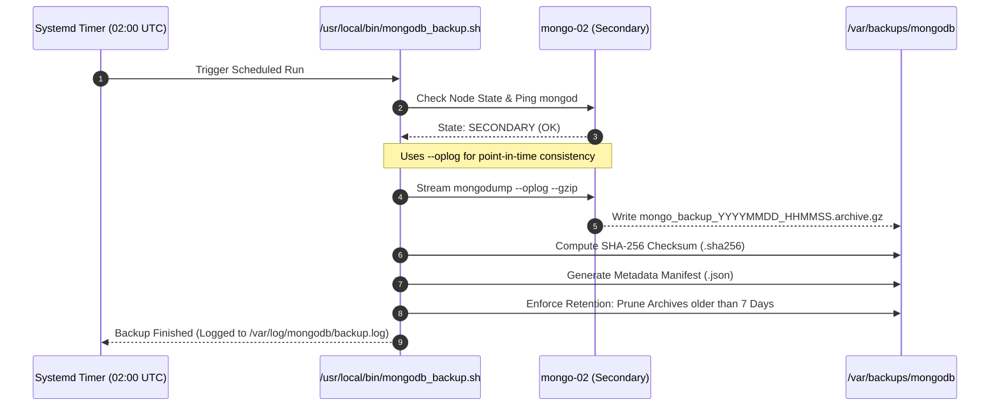
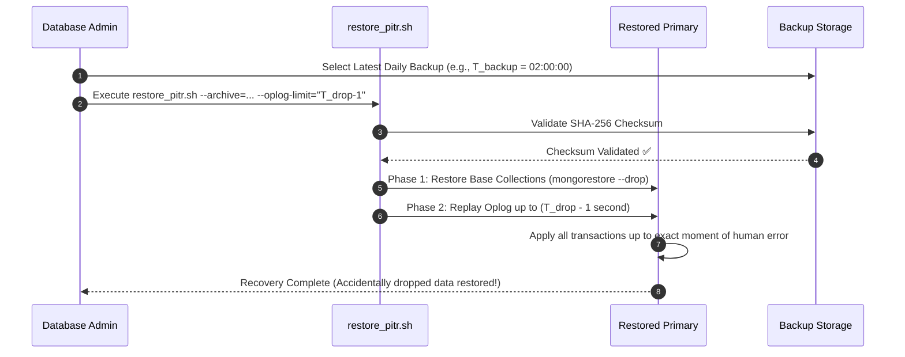

# Backup Strategy & Disaster Recovery (DR)

## 1. Overview

Data protection in MongoDB Enterprise Cluster is built on two pillars:
1. **Automated & On-Demand Consistent Backups:** Non-blocking backups taken from a designated **SECONDARY** node using `mongodump` with `--oplog` and SHA-256 integrity verification.
2. **Disaster Recovery (DR) & Point-In-Time-Recovery (PITR):** Systematic restoration workflows capable of restoring an entire cluster or rewinding transactions to the precise second prior to accidental data loss or logical corruption.

---

## 2. Automated Backup Architecture

To ensure zero performance impact on live client write workloads, automated backups are executed on `mongo-02` (Secondary).



### Key Technical Attributes:
- **`--oplog` Guarantee:** Captures all operations executed on the cluster while the backup is running. When restored, the archive replays those writes to deliver an exact, consistent point-in-time state without requiring a cluster lock (`fsyncLock`).
- **Cryptographic Tamper-proofing:** Generates `.sha256` checksum files alongside every archive.
- **Automated Lifecycle & Retention:** Deletes archives older than `backup_retention_days` (default 7 days) to prevent disk exhaustion.

---

## 3. Disaster Recovery (DR) Scenarios & Solutions

| Failure Scenario | Impact | Recovery Mechanism | Recovery Time Objective (RTO) | Recovery Point Objective (RPO) |
| :--- | :--- | :--- | :--- | :--- |
| **Node Crash / Hardware Failure** | Single node goes offline | **Automatic Replica Set Failover:** Quorum elects new Primary in 2–3s. When old node restarts, it replays missed oplog delta automatically. | $< 3$ seconds | $0$ (with `w: majority`) |
| **Accidental Data Drop (`db.dropCollection()`)** | Unwanted deletion replicated to all nodes | **Point-In-Time-Recovery (PITR):** Restore latest full backup archive, then replay oplog terminating right before the drop timestamp. | $10 - 20$ minutes | $< 1$ second |
| **Catastrophic Infrastructure Loss** | All VMs or subnets destroyed | **Full Cluster Re-provision & Restore:** Re-deploy infrastructure via Pulumi/Ansible, then execute `playbooks/08_restore_disaster_recovery.yml`. | $15 - 30$ minutes | $< 24$ hours (or latest backup) |

---

## 4. Point-In-Time-Recovery (PITR) Flow

When someone makes an accidental drop or update at $T_{\text{drop}}$:



---

## 5. Operations & Command Reference

### 1. Trigger an On-Demand Backup Manually
To trigger an immediate backup right before making a risky schema migration:
```bash
# Using CLI script from repository:
./scripts/trigger_backup.sh

# Or with Ansible playbook:
ansible-playbook playbooks/07_trigger_manual_backup.yml

# To trigger AND download the backup archive to your local controller:
ansible-playbook playbooks/07_trigger_manual_backup.yml -e "fetch_to_controller=true"
```

### 2. Check Backup Logs & Systemd Timer
On the secondary backup node (`mongo-02`):
```bash
# Check timer schedule:
systemctl list-timers mongodb-backup.timer

# View backup execution logs:
tail -f /var/log/mongodb/backup.log

# List stored backup archives:
ls -lh /var/backups/mongodb/
```

### 3. Execute Disaster Recovery / Full Cluster Restore
To restore data to the Primary node:
```bash
# 1. Restore the most recent backup automatically:
ansible-playbook playbooks/08_restore_disaster_recovery.yml

# 2. Restore a specific backup archive with existing collection drop:
ansible-playbook playbooks/08_restore_disaster_recovery.yml \
  -e "restore_archive=/var/backups/mongodb/mongo_backup_20261011_020000.archive.gz restore_drop=true"

# 3. Restore with Point-In-Time Oplog Replay (stopping at timestamp 1712839200):
ansible-playbook playbooks/08_restore_disaster_recovery.yml \
  -e "restore_archive=/var/backups/mongodb/mongo_backup_20261011_020000.archive.gz restore_oplog_limit='1712839200:1'"
```

