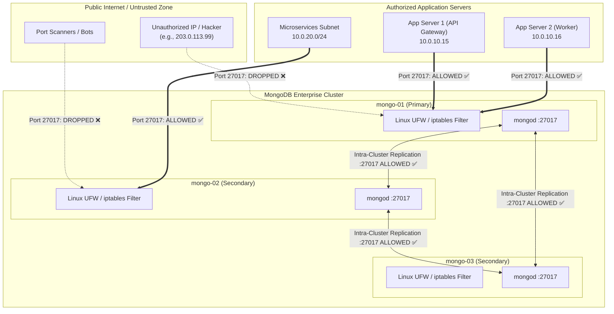

# Database Access Restriction & Application Server Binding

## 1. Overview & Security Model

In an enterprise MongoDB deployment, databases must never be directly exposed to the open internet. Access to the MongoDB database port (`27017`) is strictly bound to authorized application servers (such as API gateways, backend services, or worker clusters) and internal cluster peer nodes.

Every other incoming IP connection to port `27017` is rejected or dropped at the kernel firewall level before the database process ever spends CPU cycles on handshake negotiation.

---

## 2. Network Flow Architecture



---

## 3. Configuration in Ansible (`inventory/group_vars/all.yml`)

Access control rules are managed declaratively in Ansible variables:

```yaml
# Enable firewall-based server binding
firewall_access_control_enabled: true
firewall_allow_ssh: true
ssh_port: 22

# List of allowed application server IPs or CIDR subnets
mongo_allowed_app_clients:
  - "10.0.10.15"       # App Server 1 (Production Backend API)
  - "10.0.10.16"       # App Server 2 (Background Queue Worker)
  - "10.0.20.0/24"     # Kubernetes / Microservices Subnet
  - "198.51.100.25"    # BI / Reporting Dedicated Server
```

---

## 4. How the Firewall Rules Work

When `playbooks/05_setup_firewall_access.yml` executes:
1. **Management Safety:** Ensures port `22/tcp` (SSH) is explicitly open so administrators never get locked out.
2. **Loopback Traffic:** Permits all traffic on `lo` interface (`127.0.0.1`).
3. **Cluster Internal Mesh:** Dynamically gathers private and public IP addresses of all cluster nodes (`mongo-01`, `mongo-02`, `mongo-03`) and opens port `27017` specifically between them for replication heartbeats and oplog streaming.
4. **Application Client Whitelist:** Adds explicit allow rules for every IP and CIDR specified in `mongo_allowed_app_clients`.
5. **Default Deny Policy:** Enforces `ufw default deny incoming` and drops any connection from unauthorized IP addresses.

---

## 5. Deployment & Management Commands

### Apply or Update Firewall Rules
Whenever you need to add or remove an application server:
1. Add the new IP/CIDR to `mongo_allowed_app_clients` in `inventory/group_vars/all.yml`.
2. Run the playbook (this takes ~10 seconds and does NOT require restarting MongoDB):
   ```bash
   ansible-playbook playbooks/05_setup_firewall_access.yml
   ```

### Verify Active Rules on a Cluster Node
SSH into any node and inspect active UFW rules:
```bash
sudo ufw status verbose
```
Example output:
```text
Status: active
Logging: on (low)
Default: deny (incoming), allow (outgoing), disabled (routed)

To                         Action      From
--                         ------      ----
22/tcp                     ALLOW IN    Anywhere                   (SSH Management Access)
27017/tcp                  ALLOW IN    10.0.1.30                  (Cluster Peer Node - mongo-01)
27017/tcp                  ALLOW IN    10.0.2.51                  (Cluster Peer Node - mongo-02)
27017/tcp                  ALLOW IN    10.0.3.43                  (Cluster Peer Node - mongo-03)
27017/tcp                  ALLOW IN    10.0.10.15                 (Authorized App Server Client)
27017/tcp                  ALLOW IN    10.0.20.0/24               (Authorized App Server Client)
27017/tcp                  DENY IN     Anywhere                   (Block all unauthorized traffic)
```

### Test Connectivity from an Application Server
From an authorized application server:
```bash
./scripts/test_client_access.sh <MONGO_PRIMARY_IP> 27017
# Output: ✅ ACCESS GRANTED: Connection succeeded.
```

From an unauthorized / blocked server:
```bash
./scripts/test_client_access.sh <MONGO_PRIMARY_IP> 27017
# Output: 🛑 ACCESS DENIED / BLOCKED: Connection timed out or was rejected.
```

