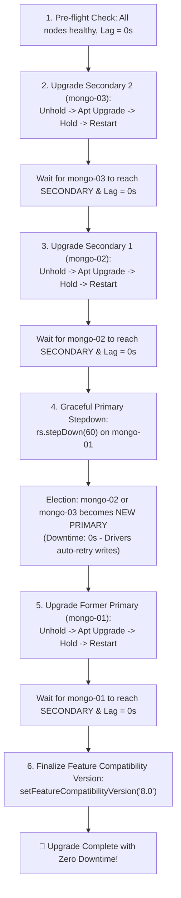

# Zero-Downtime MongoDB Version Migration & Rolling Upgrades

## 1. Principles of Zero-Downtime Upgrades

MongoDB Replica Sets are engineered for high availability, allowing major and minor version upgrades without application downtime. 

Applications connected using modern MongoDB drivers configured with:
```text
replicaSet=rs-prod-01&retryWrites=true&retryReads=true&w=majority
```
automatically handle topology changes. When the Primary steps down, client drivers detect the failover and transparently retry pending writes against the newly elected Primary within 1–2 seconds without throwing fatal errors to users.

---

## 2. Upgrade Rule: Sequential Major Versions Only

MongoDB requires sequential version progression:
$$\text{MongoDB 6.0} \longrightarrow \text{MongoDB 7.0} \longrightarrow \text{MongoDB 8.0}$$

> [!CAUTION]
> Direct version skipping (e.g., jumping from `6.0` directly to `8.0`) is unsupported by MongoDB. You must first upgrade from `6.0` to `7.0`, set `featureCompatibilityVersion: "7.0"`, and only then proceed from `7.0` to `8.0`.

---

## 3. Rolling Upgrade Process Flow



---

## 4. Phase-by-Phase Walkthrough

### Phase 1: Pre-Flight Health Check
Before touching any binaries, verify:
1. Replica set has an active Primary.
2. All nodes report `health: 1` and `stateStr: PRIMARY` or `SECONDARY`.
3. Replication lag across all secondaries is $0$ seconds.
4. Current `featureCompatibilityVersion` (FCV) matches the currently running binary version.

### Phase 2: Upgrade Secondary Nodes One by One
For each Secondary (`mongo-03`, then `mongo-02`):
1. Remove `dpkg` package hold:
   ```bash
   sudo apt-mark unhold mongodb-org mongodb-org-server mongodb-org-mongos mongodb-org-tools mongodb-mongosh
   ```
2. Update the repository file to the target version (e.g. `8.0`).
3. Upgrade packages:
   ```bash
   sudo apt-get install -y --only-upgrade mongodb-org mongodb-org-server mongodb-org-mongos mongodb-org-tools mongodb-mongosh
   ```
4. Re-pin packages to prevent unwanted updates:
   ```bash
   sudo apt-mark hold mongodb-org mongodb-org-server mongodb-org-mongos mongodb-org-tools mongodb-mongosh
   ```
5. Restart `mongod` service:
   ```bash
   sudo systemctl restart mongod
   ```
6. Poll `rs.status()` until the node completes sync and transitions back to `SECONDARY`.

### Phase 3: Step Down the Primary
Once all Secondaries are upgraded and healthy:
1. On `mongo-01` (Primary), issue a stepdown command:
   ```javascript
   rs.stepDown(60)
   ```
2. The Primary transitions to `SECONDARY`.
3. The remaining nodes hold an election. Because `mongo-02` and `mongo-03` are upgraded, one of them becomes the new **PRIMARY**.
4. Client applications seamlessly redirect write traffic to the new Primary.

### Phase 4: Upgrade Former Primary
`mongo-01` is now operating as a Secondary node.
1. Repeat the exact upgrade sequence as in Phase 2 on `mongo-01`.
2. Restart `mongod` and verify it rejoins the cluster as a healthy `SECONDARY`.

### Phase 5: Finalize Feature Compatibility Version (FCV)
All nodes in the cluster are now running the target MongoDB binaries. The final step is enabling the new version's internal storage and metadata features:
```javascript
db.adminCommand({ setFeatureCompatibilityVersion: "8.0" })
```
Verify FCV:
```javascript
db.adminCommand({ getParameter: 1, featureCompatibilityVersion: 1 })
```

---

## 5. Execution Commands

### Automated Rolling Upgrade via Ansible (Recommended)
You can execute the entire zero-downtime rolling upgrade with a single command:

```bash
ansible-playbook playbooks/09_rolling_upgrade.yml \
  -e "target_upgrade_version=8.0 target_feature_compatibility_version=8.0"
```

### Pre-Upgrade Cluster Verification Script
```bash
./scripts/rolling_upgrade_check.sh <PRIMARY_IP> 27017 clusterAdmin "ClusterAdminSecret2026!"
```

### Testing Write Availability During the Upgrade
In a separate terminal, run the resilience test while the upgrade playbook runs:
```bash
cd test-app
npm test
# Or run continuous writes:
npm run resilience
```
Observe that write operations continue to succeed before, during, and after the primary stepdown!

