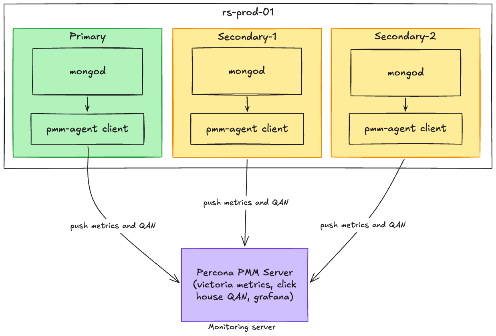
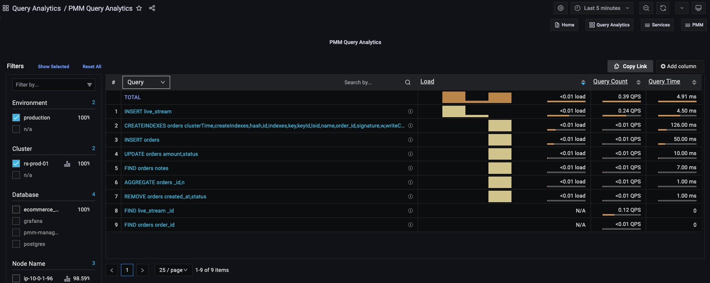
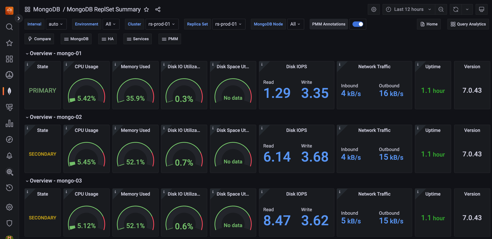
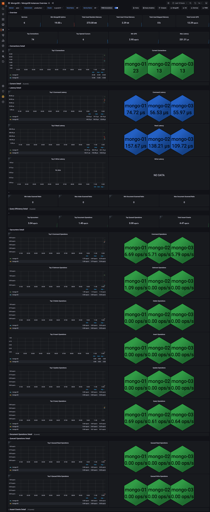
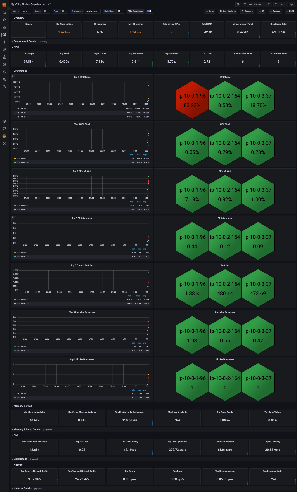

# MongoDB Profiling and Percona PMM Monitoring

## 1. Architecture Diagram

This diagram shows how the three MongoDB replica set nodes connect to the dedicated PMM monitoring server.



## 2. Essential Commands

### Step 1: Deploy PMM Monitoring Server
Run this command to start the PMM Server container using Docker:
```bash
ansible-playbook -i inventory/hosts.ini playbooks/13_deploy_pmm_server.yml
```

### Step 2: Install PMM Client and Register MongoDB Nodes
Run this command to install the client, connect to PMM Server, and start query profiling:
```bash
ansible-playbook -i inventory/hosts.ini playbooks/12_install_pmm_client.yml
```

### Step 3: Verify Client and Service Status
Check the status of all agents and registered services across the cluster:
```bash
ansible mongodb_cluster -i inventory/hosts.ini -m command -a "pmm-admin list"
```

Or run the automated verification script:
```bash
./scripts/verify_pmm.sh
```

### Step 4: Generate Live Traffic for Profiling
Generate real read and write queries from the test application:
```bash
cd test-app
npm run writer
npm run reader
npm run qan
```

## 3. Monitoring Dashboards

### Query Analytics (QAN)
This dashboard tracks query fingerprints, load breakdown, execution counts, and query latency across cluster nodes.



### Replica Set Summary
This dashboard tracks primary status, secondary nodes, replication lag, and real-time opcounters for reads and writes.



### MongoDB Instance Overview
This dashboard tracks database throughput, connections, WiredTiger cache usage, and execution latency.



### Node and OS Overview
This dashboard tracks CPU usage, memory utilization, disk IOPS, and network traffic for each host machine.



### PMM Query Analysis (QAN)
QAN (Query Analytics) is a feature of PMM (Percona Monitoring and Management) that helps analyze database query performance.

